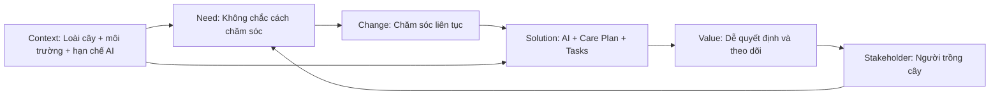

# Plant Care — BACCM Analysis

> **Status:** Draft · **Method:** Business Analysis Core Concept Model (BACCM) · **Scope:** Product discovery, not deployed behavior

BACCM giúp xác định **Change, Need, Solution, Stakeholder, Value, Context** và mối liên hệ giữa chúng. Đây là phân tích ban đầu, không thay thế việc phỏng vấn và xác nhận thực tế với người dùng.

| Core Concept | Phân tích Plant Care | Giả định cần kiểm chứng |
|---|---|---|
| **Change** | Chuyển từ tìm lời khuyên rời rạc sang quy trình chăm sóc cây liên tục có ghi nhận | Người dùng sẵn sàng duy trì việc theo dõi trên ứng dụng |
| **Need** | Nhận diện cây, hiểu nhu cầu, không quên lịch chăm sóc, xử lý triệu chứng | Nhắc việc và checklist là khó khăn thực sự, không chỉ là nhu cầu được suy đoán |
| **Solution** | AI Identify/Diagnose + My Plants + Care Plan được duyệt + Care Task & History | Người dùng tin tưởng kế hoạch AI và hiểu giới hạn của nó |
| **Stakeholder** | Người trồng cây, Product Owner, BA, Backend/Frontend Developer, QA, AI provider | Chưa có phỏng vấn trực tiếp hoặc thông tin đối tác chuyên môn |
| **Value** | Giảm cảm giác không chắc chắn; cải thiện khả năng theo dõi và quyết định chăm sóc | Chưa có dữ liệu chứng minh tác động lên sức khỏe cây |
| **Context** | Trồng cây tại nhà/căn hộ; môi trường ánh sáng, nước, khí hậu, internet và AI không hoàn hảo | Thói quen người dùng thay đổi theo loài cây và khu vực |

## Relationship diagram

## Business hypotheses

| ID | Hypothesis | Phương pháp kiểm chứng đề xuất |
|---|---|---|
| H-01 | Người mới có khó khăn đáng kể trong việc theo dõi chăm sóc cây | Phỏng vấn 5–8 người dùng mục tiêu, chưa thực hiện |
| H-02 | Họ muốn phê duyệt kế hoạch trước khi kích hoạt | Thử prototype/đo accept-reject |
| H-03 | Checkbox theo từng công việc dễ dùng hơn nhật ký thủ công | Usability test theo tác vụ |
| H-04 | Chỉ có Accept/Reject mà không sửa/tạo lại có thể gây bế tắc | Đo tỷ lệ từ chối và bỏ dở onboarding |

## Discovery outcome

Các Product Decisions PD-002 đến PD-012 đã xác định **MVP behavior mong muốn** cho Care Planning & Tracking; không phải bằng chứng đã phát triển hoặc đã kiểm chứng với người dùng thật.

## Open questions

- Nếu người dùng Reject kế hoạch trong MVP, có thể tiếp tục dùng phần nào của ứng dụng?
- Người dùng bỏ qua câu hỏi cá nhân hóa và bổ sung thông tin sau sẽ được hưởng lợi như thế nào khi MVP không tạo lại kế hoạch?
- Notification trong ứng dụng hay push notification?
- Cơ chế account, ownership, deletion và lưu dữ liệu ảnh?

Xem [Product Decisions](../06-decisions/product/README.md) và [Business Requirements](../02-business-analysis/requirements/business-requirements.md).
