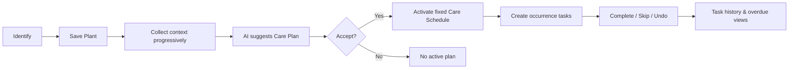

# Plant Care — Product Roadmap & MVP Scope

> **Status:** Draft proposal. Roadmap không phải bằng chứng tính năng đã chạy.

## Capability roadmap

| Stage | Mục tiêu | Phạm vi | Status |
|---|---|---|---|
| **Foundation (current)** | AI analysis API cơ bản | Identify (1 image), Diagnose (2 images), health endpoints | Implemented in source; quality/production readiness cần xác minh riêng |
| **MVP end-to-end (proposed)** | Người dùng lưu và theo dõi cây liên tục | My Plants, progressive onboarding, AI plan approval, task recurrence/checklist/history | Planned |
| **Follow-up (proposed)** | Xử lý phản hồi và thích ứng | Regenerate plan, edit/feedback, AI plan update approval | Deferred by PD-012 for MVP |
| **Future (exploration)** | Chăm sóc thông minh hơn | Push notification, trend analytics, prediction, richer health tracking | Not committed |

## MVP vertical slice

## MVP scope proposal

| Epic | Priority | Basis / condition |
|---|---|---|
| Plant Identification | Must | Existing backend capability |
| My Plant Collection | Must | Persist and identify ownership of plants |
| Progressive Personalization | Must | PD-003; skip optional detail; unknown is not fabricated |
| Care Planning | Must | User accepts or rejects AI proposal |
| Care Tracking | Must | Individual tasks, recurrence, Skip, Undo, Overdue |
| Plant Diagnosis | Should (integration) | API exists; user journey integration to be scoped |
| Push Notifications | TBD | No confirmed delivery channel |
| Replanning / feedback | Out for MVP | PD-011/PD-012 |

## Proposed execution order (implementation, not approved sprint plan)

1. Clarify plant ownership/account and minimal database entities.
2. Implement persistent plant profile and saved identification result.
3. Implement plan draft and accept/reject, preserving original AI output where useful.
4. Implement `CareSchedule` and individual `CareTask` occurrences; timezone/dedup rules required.
5. Implement checklist, completion/skip/undo, history, overdue display and tests.
6. Connect Diagnose to a saved plant and assess optional notifications.

## Release gates

- Functional acceptance criteria for MVP user journey have tests/UAT evidence.
- No claims of planted outcomes beyond supporting evidence.
- Production guidance explicitly distinguishes recommendations from certainty.
- Reliability, security, data retention, and privacy decisions documented before user-data deployment.

See [Business Requirements](../02-business-analysis/requirements/business-requirements.md) and [Open Decisions](../06-decisions/product/README.md).
