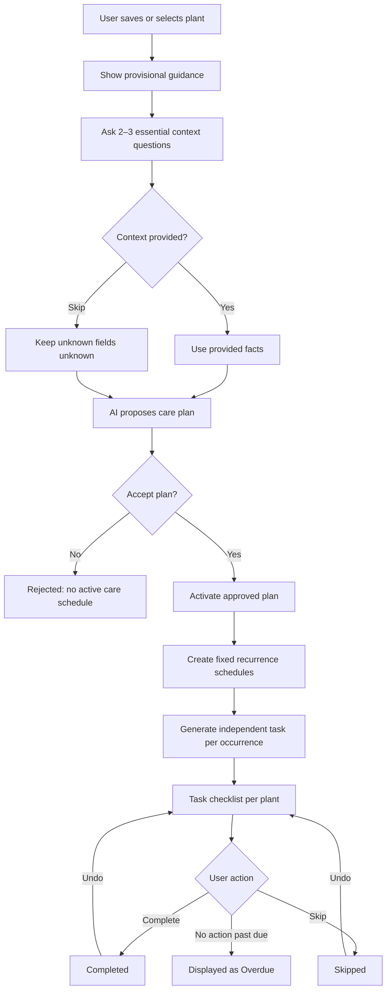
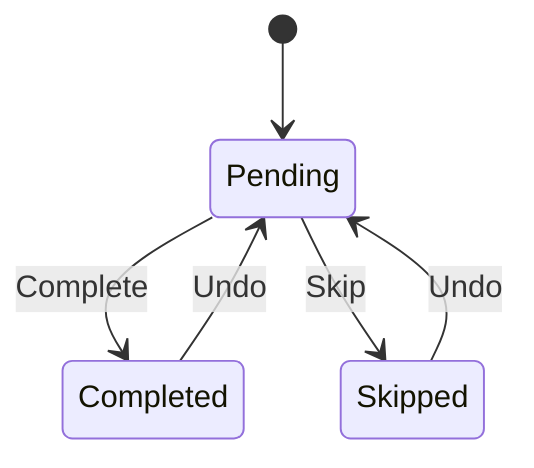

# Care Planning & Tracking — Feature Specification

> **Status:** Draft functional specification · **Implementation:** Planned / not in current backend · **Related business goals:** BR-03, BR-04 · **Decisions:** PD-002–PD-012

## 1. Problem & objective

Người dùng mới cần hướng dẫn chăm sóc theo bối cảnh nhưng không muốn quản lý lịch bằng trí nhớ. Tính năng cho phép AI **đề xuất** kế hoạch, người dùng **chấp nhận hoặc từ chối**; kế hoạch được chấp nhận sinh các hoạt động có thể theo dõi theo từng kỳ.

## 2. Actors & scope

- **Primary actor:** Plant Owner.
- **Supporting actors/services:** AI analyzer, future application scheduler.
- **In MVP:** đề xuất kế hoạch (chưa triển khai), phê duyệt, tạo task định kỳ cố định, hiển thị checklist, Complete, Skip, Undo, Overdue, history cơ bản.
- **Out of MVP:** tự chỉnh sửa kế hoạch, gửi feedback để sửa, regenerate plan khi Reject, tự kích hoạt AI update; push notification chưa chốt.

## 3. Main journey

## 4. Functional requirements

| ID | Requirement | Priority | Related rule |
|---|---|---|---|
| FR-CP-01 | Hiển thị hướng dẫn chăm sóc tổng quát trước khi đủ dữ liệu cá nhân hóa và nêu rõ đó là hướng dẫn tổng quát | Must | BRU-01 |
| FR-CP-02 | Hỏi từng bước 2–3 thông tin quan trọng; cho phép Skip; các field bỏ qua lưu ở trạng thái unknown | Must | BRU-02 |
| FR-CP-03 | AI tạo bản đề xuất kế hoạch rõ nội dung và tần suất công việc để user xem xét | Must | BRU-03 |
| FR-CP-04 | User có thể Accept hoặc Reject bản đề xuất | Must | BRU-03/04 |
| FR-CP-05 | Hệ thống chỉ kích hoạt Care Schedule từ kế hoạch đã Accept | Must | BRU-03 |
| FR-CP-06 | Mỗi công việc là một task riêng có due date và liên kết plant/schedule/occurrence | Must | BRU-05/08 |
| FR-CP-07 | User đánh dấu Complete cho một task; hệ thống không yêu cầu chứng minh hành vi | Must | BRU-06 |
| FR-CP-08 | User đánh dấu Skip; không biến task thành Completed hoặc dời lịch tương lai | Must | BRU-09 |
| FR-CP-09 | User Undo từ Completed/Skipped về Pending | Must | BRU-10 |
| FR-CP-10 | User nhìn thấy Pending task quá due date là Overdue; giữ due date gốc | Must | BRU-07 |
| FR-CP-11 | Sinh task cho từng kỳ của schedule dù kỳ trước chưa giải quyết | Must | BRU-08 |
| FR-CP-12 | Lịch cố định không được tự tính lại từ ngày user Complete muộn | Must | BRU-11 |
| FR-CP-13 | User có thể xem các task và lịch sử trạng thái theo đúng cây | Must | BRU-05/09 |

**Draft modeling:** `Plant`, `CarePlan` (draft/accepted/rejected), `CareSchedule`, `CareTask`. Chỉ là các **khái niệm nghiệp vụ**, chưa phải tên bảng hay class đã chốt.

## 5. Use cases

### UC-CP-01 — Approve care plan

**Precondition:** User có cây đang được xem xét; AI tạo được bản đề xuất.

**Main flow:** (1) System hiển thị nội dung/điều kiện/tần suất; (2) User nhấn Accept; (3) System ghi nhận bản phê duyệt; (4) System kích hoạt lịch; (5) User thấy công việc của cây.

**Alternative:** User nhấn Reject → proposal bị từ chối, không tạo active schedule. UX sau Reject còn là **Open Question**; không được âm thầm tự tạo lại.

**Exception:** AI unavailable → không thể trình bày proposal mới; không tạo plan giả. Persist/activation failure → không báo thành công nếu chưa lưu.

### UC-CT-01 — Process care task

**Precondition:** Task thuộc cây và user có quyền thao tác (ownership policy chưa chốt).

**Main flow:** User mở checklist → chọn một task → đánh dấu Complete hoặc Skip → trạng thái được ghi nhận → chỉ task đó thay đổi.

**Alternative:** User nhấn Undo → task về Pending; nếu quá hạn thì nhìn thấy Overdue.

**Exception:** Task không tồn tại, không thuộc cây, hoặc concurrency conflict → không được âm thầm thay đổi task khác; API status cần thiết kế sau.

## 6. User stories & acceptance criteria

### US-CP-01 — Review AI proposal

**As a** beginner plant owner, **I want** to review an AI-proposed care plan before activating it, **so that** I remain in control of my plant-care routine.

- **Given** AI has returned a plan proposal, **when** I choose Accept, **then** the plan is marked accepted and only its schedules become active.
- **Given** a proposed plan, **when** I choose Reject, **then** it is not activated and no active recurrence is generated from that rejection.
- **Given** an AI failure, **when** a proposal cannot be generated, **then** the system does not claim an approved plan exists.

### US-CT-01 — Track independent occurrences

**As a** plant owner, **I want** each scheduled care action to be a separate checklist item, **so that** I can track exactly what I did or skipped.

- **Given** watering-check schedule every 5 days, due 10/11 and 15/11, **when** I complete the 10/11 task on 12/11, **then** the next occurrence is still due 15/11.
- **Given** an earlier occurrence is overdue, **when** the next scheduled date arrives, **then** a distinct new occurrence is created without completing or removing the old one.
- **Given** a task is Pending and time is past `dueAt`, **when** the checklist loads, **then** it shows Overdue with original `dueAt`.

### US-CT-02 — Skip and undo

**As a** plant owner, **I want** to skip or undo a task status, **so that** my checklist reflects what I reported.

- **Given** a Pending task, **when** I select Skip, **then** it becomes Skipped, not Completed.
- **Given** a Completed or Skipped task, **when** I select Undo, **then** it becomes Pending and does not retain contradictory completion/skip timestamps.
- **Given** one task is changed, **when** I inspect another occurrence, **then** its status remains unchanged.

## 7. State model

**Overdue:** Derived display condition `status === Pending && now > dueAt`; not a separate stored transition. Acceptance of timezone/range boundary remains pending.

## 8. Business risks and constraints

- Nhắc `Check soil moisture` khác với mệnh lệnh `Water plant now`; không tạo nguy cơ tưới bù nhiều lần vì nhiều task đã Overdue.
- Không suy ra action được thực hiện thực tế chỉ vì user bấm Complete.
- Không sửa plan tự động khi AI phân tích dữ liệu mới; PD-004 yêu cầu consent, PD-012 trì hoãn regeneration trong MVP.
- Nếu user Reject thì Care Tracking cho plan này chưa bắt đầu. Đây là known UX limitation.

## 9. Open questions / dependencies

| ID | Decision required | Impact |
|---|---|---|
| OQ-CP-01 | UI và quyền tiếp tục sau Reject | Onboarding drop-off |
| OQ-CP-02 | Bổ sung dữ liệu sau khi đã Accept: chỉ lưu profile hay tạo flow riêng sau MVP | Progressive personalization consistency |
| OQ-CP-03 | Lưu task trong timezone nào, xác định due date và repeated job semantics | Recurrence correctness |
| OQ-CP-04 | Tạo task sẵn trước nhiều kỳ hay just-in-time | Scheduler design |
| OQ-CP-05 | Có login/anonymous mode, ownership, deletion thế nào | Data privacy |
| OQ-CP-06 | In-app reminders hay push notifications | MVP scope |

## 10. Traceability

- Business Requirements: [BR-03 / BR-04](../requirements/business-requirements.md)
- Business Rules: [BRU-01–BRU-16](../requirements/business-rules.md)
- Decisions: [PD-002–PD-012](../../06-decisions/product/README.md)
- Technical design: **Not yet authored** for Care Planning; [System Overview](../../03-system-design/architecture/system-overview.md) describes only existing backend.
- Implementation: **Not in `main` source** at time of review.
