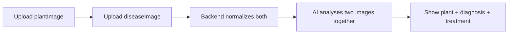

# Plant Diagnosis — Feature Specification

> **Status:** Draft BA specification · **Implementation evidence:** `POST /plants/diagnose` exists in backend `main` · **Longitudinal diagnosis history:** Planned

## Objective

Cho phép người dùng cung cấp ảnh tổng thể cây và ảnh chi tiết vùng nghi có vấn đề để nhận gợi ý ban đầu về tình trạng, mức độ nghiêm trọng tương đối, nguyên nhân có thể và hướng xử lý từ AI. Kết quả không phải chẩn đoán chuyên gia được kiểm chứng.

## User story

**As a** plant owner, **I want** to upload an overall plant photo and a symptom photo, **so that** I can obtain preliminary diagnosis and suggested treatment actions.

## Main flow



## Functional requirements and acceptance criteria

| ID | Given / When / Then | Status |
|---|---|---|
| FR-DG-01 | Given two valid image fields `plantImage` and `diseaseImage`, when request is submitted, then backend analyzes both and returns result JSON | Implemented in source |
| FR-DG-02 | Given one image field missing, when submitted, then backend returns 400 | Implemented in source |
| FR-DG-03 | Given invalid/corrupted/unsupported image data, then backend rejects input rather than passing it as trusted | Implemented in source |
| FR-DG-04 | Given a valid AI response, then it contains `plant`, `diagnosis`, `treatment` per domain contract | Implemented in source |
| FR-DG-05 | Given AI unavailable, rate limited or timed out, then backend returns mapped HTTP error; no false success | Implemented in source |
| FR-DG-06 | Saved diagnosis history can be viewed for a plant | Planned — not in `main` |

## Current response contract

```json
{
  "plant": { "commonName": "string", "scientificName": "string" },
  "diagnosis": {
    "condition": "string",
    "severity": "low | medium | high",
    "possibleCauses": ["string"]
  },
  "treatment": { "actions": ["string"], "notes": ["string"] }
}
```

This is a **field-shape illustration**, not a fabricated example diagnosis. The service validates provider output with Zod before returning it.

## Exceptions & safeguards

- `plantImage` and `diseaseImage` have different semantic roles and must preserve order in provider input.
- AI-generated diagnosis is a hypothesis; display wording should avoid implying certainty.
- Do not claim diagnoses are persisted or linked to user accounts yet.
- Whether image storage, user history, or clinician/botanist escalation exists is not decided.

## Links

- [API overview](../../04-api/api-overview.md)
- [Gemini integration](../../03-system-design/integrations/gemini-integration.md)
- [Diagnosis use-case test flow](../../05-testing/diagnose-usecase-workflow.md)
- [ADR-003](../../06-decisions/architecture/ADR-003-two-image-diagnosis.md)
