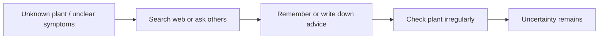
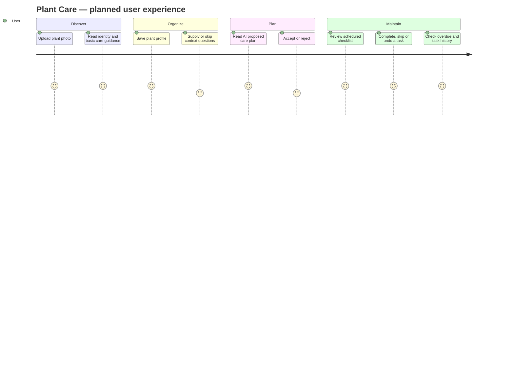
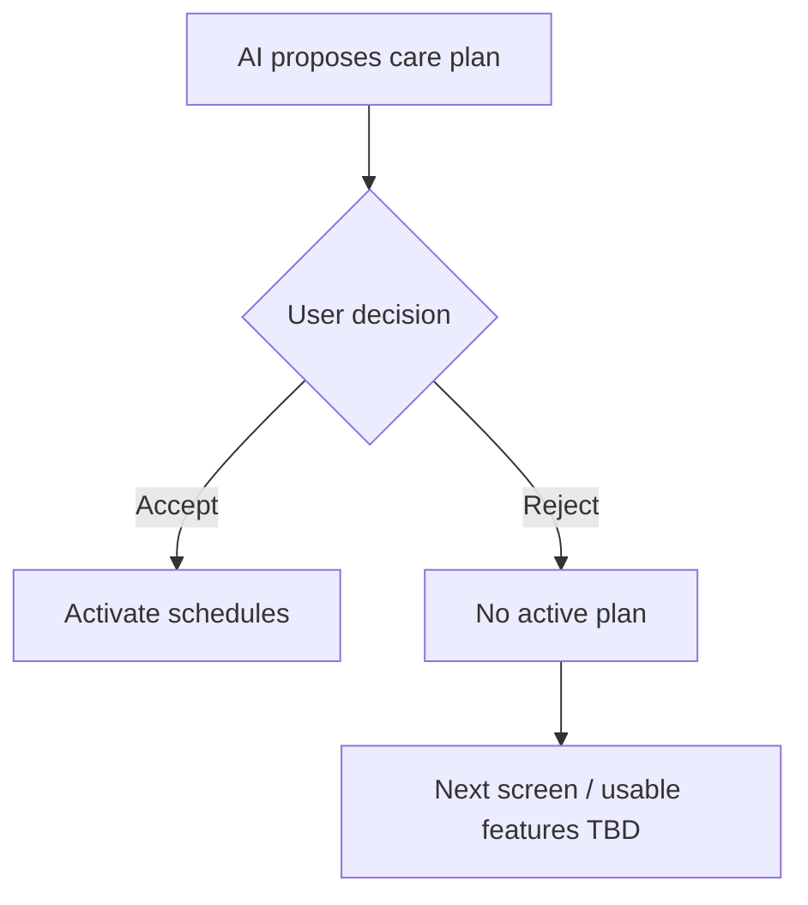

# Plant Care — User Journey (As-is / To-be)

> **Status:** Draft business process · **Not an existing UI screenshot or implemented UX**

## Primary persona and trigger

**Beginner indoor plant owner** has a plant, wants to know what it is and how to maintain it without forgetting key checks.

## As-is journey (hypothesis to validate)

No user research has yet validated every step of this as-is journey.

## To-be journey (MVP proposal)

Scores in Mermaid are **illustrative sentiment only** and not measured satisfaction data.

## Journey details

| Stage | User action | System response | Potential friction | Related feature |
|---|---|---|---|---|
| Discover | Upload image | Return identity, requirements, textual care recommendation | Wrong/uncertain identification | Plant Identification — API exists |
| Organize | Save plant | Persist plant profile | Login and plant ownership not chosen | My Plant Collection — Planned |
| Personalize | Answer or skip questions | Preserve unknown data; distinguish generic vs personalized | Extra questions cause abandonment | Progressive Personalization — Planned |
| Approve | Accept/Reject proposed plan | Accept activates schedules; Reject does not | Reject without alternative is dead-end | Care Planning — Planned |
| Maintain | Complete/Skip/Undo each task | Update only selected occurrence | Many overdue occurrences could be confusing | Care Tracking — Planned |
| Diagnose | Upload two images for symptom check | Return preliminary condition/causes/treatment | False confidence in AI output | Diagnose — API exists |

## Critical branch: plan rejected

## Validation plan

Run lightweight usability tests for image upload, skipping context, reviewing plan and updating a task. Observe if users understand that fixed schedule may mean **check conditions**, not automatically water.

Related: [Care Planning](../features/care-planning.md), [BACCM](../../01-product/baccm-analysis.md), [Roadmap](../../01-product/roadmap.md).
