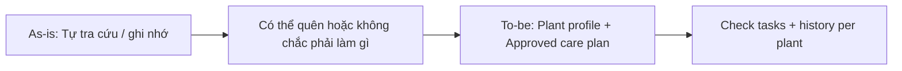

# Plant Care — Business Requirements

> **Status:** Draft · IDs identify business outcomes, **not API tickets**. Requirements below derive from product discussions and code review; acceptance by a stakeholder remains pending.

## Business problem

Người trồng cây mới thiếu kiến thức và khó duy trì việc chăm sóc đều đặn. Một lần nhận diện hoặc chẩn đoán bằng AI không giải quyết việc quản lý nhiều cây và công việc về lâu dài.

## Business goals

| ID | Business requirement (outcome) | Value hypothesis | Proposed validation |
|---|---|---|---|
| **BR-01** | Giúp người dùng tìm hiểu danh tính và nhu cầu cơ bản của cây từ ảnh | Giảm thao tác tra cứu thủ công | Usability test Identify, phản hồi hữu ích |
| **BR-02** | Giúp người dùng tổ chức thông tin cây thành bộ sưu tập cá nhân | Có ngữ cảnh xuyên suốt giữa các phiên | Tỷ lệ người dùng lưu được cây |
| **BR-03** | Cho người dùng một kế hoạch chăm sóc hiểu được và do họ chấp nhận | Tăng cảm giác chủ động, giảm hướng dẫn thiếu bối cảnh | Plan acceptance/rejection rate |
| **BR-04** | Cho người dùng theo dõi từng hoạt động chăm sóc và lịch sử | Hạn chế bỏ quên, minh bạch tiến trình | Task-handled rate, overdue count |
| **BR-05** | Hỗ trợ người dùng nhận biết vấn đề sức khỏe cây qua ảnh | Cung cấp gợi ý ban đầu dễ tiếp cận | Feedback on suggested actions, QA review |

## Scope and functional traceability

| BR | Features | Implementation state |
|---|---|---|
| BR-01 | [Plant Identification](../features/plant-identification.md) | API implemented |
| BR-02 | My Plant Collection (spec pending) | Planned |
| BR-03 | [Care Planning](../features/care-planning.md) | Planned |
| BR-04 | [Care Planning & Tracking](../features/care-planning.md) | Planned |
| BR-05 | [Plant Diagnosis](../features/plant-diagnosis.md) | API implemented |

## Process impact

## Constraints

- AI output có thể sai hoặc thiếu thông tin. Không khẳng định là chẩn đoán chắc chắn.
- Trường bối cảnh chưa biết không được thay bằng giá trị do hệ thống tưởng tượng.
- MVP không cho người dùng tự sửa/đề nghị tạo lại Care Plan (PD-011, PD-012).
- Fixed schedule tạo nhiệm vụ theo kỳ độc lập; không diễn giải là phải thực hiện nhiều lần để bù việc quá hạn.
- Chưa chọn cơ chế authentication, persistence, timezone và notification; yêu cầu kỹ thuật tương ứng chưa thể coi là chốt.

## Acceptance and success

Các KPI được liệt kê là **candidate KPIs**, không có target/baseline được phê duyệt. Business acceptance sẽ được xác minh qua một luồng đầy đủ: Identify → Save → Setup → Approve → Manage tasks. Chứng cứ triển khai lấy từ code/PR và automated tests, không lấy từ file kế hoạch.

## Open decisions

1. Reject plan: người dùng quay về My Plants, vẫn có thể Diagnose hay không? (vẫn cần stakeholder approval).
2. Bổ sung thông tin cá nhân hóa sau khi lập kế hoạch: chỉ lưu hồ sơ hay tác động đến kế hoạch? Không có chức năng regenerate trong MVP.
3. Account/data ownership, timezone, notification channels và image/data retention.

Related: [BACCM](../../01-product/baccm-analysis.md) · [Business Rules](business-rules.md) · [Roadmap](../../01-product/roadmap.md).
