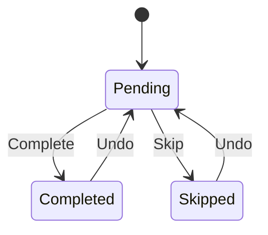
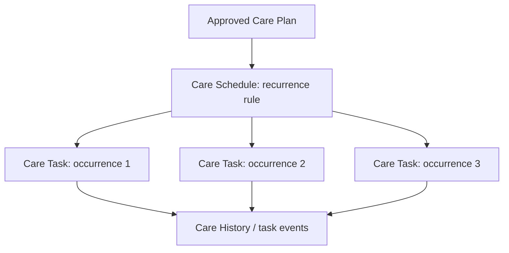

# Plant Care — Business Rules Register

> **Status:** Draft specification. `Confirmed in discovery` là đã được quyết định trong cuộc thảo luận, **không có nghĩa đã triển khai**. Các rule còn mở được gắn `Open`.

| Rule ID | Business rule | Basis | Status |
|---|---|---|---|
| **BRU-01** | Câu trả lời AI có thể cung cấp hướng dẫn tổng quát trước khi đủ dữ liệu cá nhân hóa; phải thể hiện rõ mức độ cá nhân hóa | PD-003 | Confirmed in discovery |
| **BRU-02** | Trường thông tin người dùng chưa cung cấp phải được giữ ở trạng thái chưa biết; không được tự suy đoán | PD-003 | Confirmed in discovery |
| **BRU-03** | AI đề xuất Care Plan; chỉ có kế hoạch được người dùng chấp nhận mới được kích hoạt | PD-004/011/012 | Confirmed in discovery |
| **BRU-04** | Reject không kích hoạt kế hoạch; MVP không hỗ trợ trực tiếp chỉnh sửa, phản hồi hay tạo lại kế hoạch | PD-011/012 | Confirmed in discovery |
| **BRU-05** | Mỗi hoạt động chăm sóc trong kế hoạch là một task riêng có checkbox/điều khiển riêng | PD-005 | Confirmed in discovery |
| **BRU-06** | Đánh dấu Complete là xác nhận của người dùng; không phải bằng chứng hoạt động vật lý đã được kiểm chứng | PD-005 | Confirmed in discovery |
| **BRU-07** | Một task chưa hoàn thành và qua `dueAt` hiển thị là Overdue, giữ nguyên ngày đến hạn gốc | PD-006 | Confirmed in discovery |
| **BRU-08** | Lịch định kỳ phát sinh task riêng cho mỗi kỳ kể cả khi task kỳ trước vẫn Overdue | PD-007 | Confirmed in discovery |
| **BRU-09** | Task có thể được đánh dấu Skipped; không được coi là Completed và không ngăn kỳ tiếp theo | PD-008 | Confirmed in discovery |
| **BRU-10** | Undo từ Completed hoặc Skipped trả task về Pending; hệ thống tính lại Overdue theo thời gian hiện tại | PD-009 | Confirmed in discovery |
| **BRU-11** | Lịch định kỳ theo chu kỳ cố định, không dời kỳ tiếp theo khi task được hoàn thành muộn | PD-010 | Confirmed in discovery |
| **BRU-12** | AI không được tự thay đổi một kế hoạch đã kích hoạt nếu người dùng chưa đồng ý | PD-004 | Confirmed; automatic replan deferred in MVP |
| **BRU-13** | Lịch nhắc kiểm tra điều kiện không được diễn giải mặc định là bắt buộc tưới/bón phân | Safety principle | Proposed for validation |
| **BRU-14** | Khi người dùng Reject kế hoạch, UI vẫn cho phép dùng chức năng nào? | Open question | Open |
| **BRU-15** | Khi người dùng bổ sung dữ liệu môi trường sau khi Accept, dữ liệu đó tác động ra sao nếu không có regenerate? | Open question | Open |
| **BRU-16** | Chính sách định danh kỳ lịch theo timezone, tránh tạo trùng sau retry/scheduler restart | Technical discovery | Open |

## Task state machine

**Overdue không phải trạng thái bền vững riêng trong MVP draft:** hiển thị Overdue khi `status = Pending` và `now > dueAt` (cần xác định chính xác timezone và ranh giới thời gian trong technical design).

## Distinguish schedule, occurrence, history

**Modeling note:** `CareHistory` có thể được truy vấn từ task/status và timestamps thay vì một bảng riêng. Đây là lựa chọn của System Design, chưa được quyết định trong BA.

## Consistency rule

- Undo Completed phải làm rõ hoặc reset `completedAt`; Undo Skipped phải làm rõ/reset `skippedAt`.
- `Skipped` không được tính là `Completed` trong metric.
- Không tự suy ra người dùng đã thực hiện nhiều task chỉ vì họ chọn Complete cho một task.

Reference: [Care Planning Feature Spec](../features/care-planning.md), [PD Register](../../06-decisions/product/README.md).
