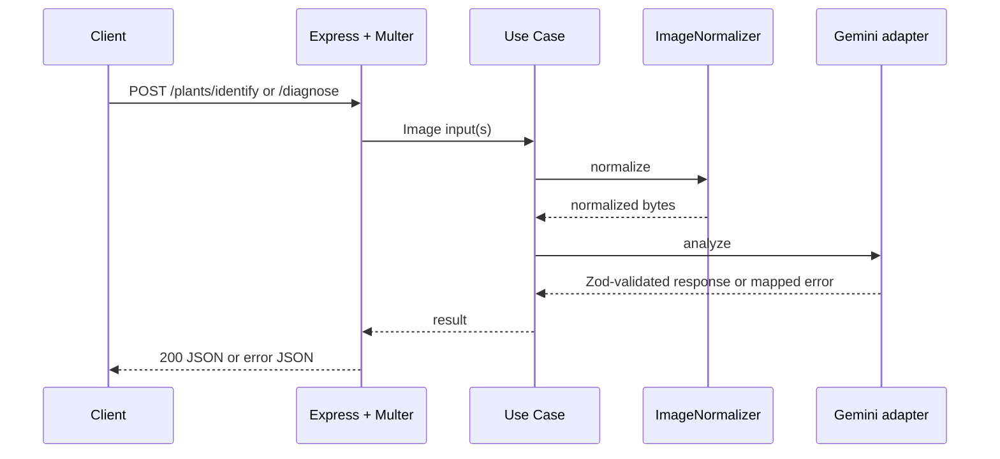

# Plant Care Backend — API Overview

> **Status:** Source-based snapshot of `main` (reviewed 2026-11-21). **This documents the existing API only**; planned Care Planning endpoints have not been designed or implemented.

## Routes

| Method | Endpoint | Request | Main success status |
|---|---|---|---|
| `POST` | `/plants/identify` | `multipart/form-data`, field `image` (one file) | `200` |
| `POST` | `/plants/diagnose` | `multipart/form-data`, fields `plantImage` & `diseaseImage` (one each) | `200` |
| `GET` | `/health` | None | `200 { "status": "ok" }` |
| `GET` | `/health/liveness` | None | `200 { "status": "alive" }` |
| `GET` | `/health/ready` | None | `200 { "status": "ready" }` or `503 { "status": "not ready" }` |

## Identify response shape

```json
{
  "overview": { "commonName": "string", "scientificName": "string", "description": "string" },
  "requirements": { "light": "string", "water": "string", "temperature": "string" },
  "carePlan": { "summary": "string", "recommendations": ["string"] }
}
```

`carePlan` is descriptive recommendations **not a persisted, approved or scheduled plan**.

## Diagnose response shape

```json
{
  "plant": { "commonName": "string", "scientificName": "string" },
  "diagnosis": { "condition": "string", "severity": "low", "possibleCauses": ["string"] },
  "treatment": { "actions": ["string"], "notes": ["string"] }
}
```

Severity enum is `low | medium | high`; values are shape examples, not verified plant diagnoses.

## Image handling

- Multer buffers uploaded files in process memory; configured per-file limit `MAX_IMAGE_MB`. **Do not hard-code 10MB as guaranteed deployment configuration**.
- Sharp reads image metadata and only allows JPEG/PNG; valid images are rotated/resized and encoded JPEG.
- `plantImage` denotes overview; `diseaseImage` denotes symptom detail; both are mandatory for Diagnose.

## Error contract (from middleware)

| Condition | Status | JSON shape / code |
|---|---|---|
| Missing Identify image | 400 | `{ "message": "Plant image is required" }` |
| Missing Diagnose image(s) | 400 | `{ "message": "plantImage and diseaseImage are required" }` |
| Invalid or unsupported image content | 400 | `{ "code": "INVALID_IMAGE" / "UNSUPPORTED_FORMAT", "message": "..." }` |
| File too large | 413 | `{ "code": "IMAGE_TOO_LARGE", "message": "..." }` |
| Other upload error | 400 | `{ "code": "UPLOAD_ERROR", "message": "..." }` |
| AI provider rate limited | 429 | `{ "code": "RATE_LIMITED", "message": "..." }` |
| AI timeout | 504 | `{ "code": "TIMEOUT", "message": "..." }` |
| AI unavailable / invalid response | 503 | `{ "code": "UNAVAILABLE" / "INVALID_RESPONSE", "message": "..." }` |
| Unknown provider error | 500 | `{ "code": "UNKNOWN", "message": "..." }` |
| Other unexpected error | 500 | `{ "code": "INTERNAL_ERROR", "message": "Internal server error" }` |

**Implementation nuance:** Some validation errors do not have a `code` field in JSON; clients must not assume all 400 responses share an identical envelope until normalized.

## Existing request flow



## Sources and next work

- Code: `src/http/routes/plant.route.ts`, `src/http/routes/health.route.ts`, `src/http/controllers`, `src/domain/plant.types.ts`, `src/http/middlewares/error-handler.middleware.ts`.
- [Feature: Identification](../02-business-analysis/features/plant-identification.md)
- [Feature: Diagnosis](../02-business-analysis/features/plant-diagnosis.md)
- Care Plan / task APIs require DB, ownership, idempotency, scheduling and error contract decisions **before API specs are authored**.
