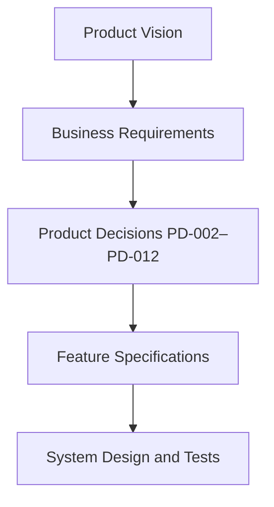

# Plant Care — Product Decision Register

> **Status:** Product Discovery decisions recorded in conversation, **not code implementation**. Technical feasibility and release acceptance require separate checks.

| ID | Decision | Consequence / scope |
|---|---|---|
| PD-002 | Kế hoạch kết hợp cá nhân hóa và kiểm tra điều kiện thực tế | Không coi lịch là lệnh hành động vô điều kiện |
| PD-003 | Progressive Personalization | Hướng dẫn tổng quát trước; hỏi 2–3 chi tiết; có Skip; Unknown không được đoán |
| PD-004 | AI đề xuất thay đổi plan, user phải đồng ý | No silent updates; phần replan hoãn trong MVP theo PD-012 |
| PD-005 | Mỗi action AI tạo là task riêng có checkbox | User confirmation accepted without physical proof |
| PD-006 | Task quá hạn giữ `dueAt` và hiển thị Overdue | Overdue có thể tính thay vì lưu status riêng |
| PD-007 | Kỳ tiếp theo tạo task độc lập dù kỳ cũ quá hạn | Không auto-complete hoặc yêu cầu bù hành động |
| PD-008 | User có thể Skip task | Skipped không đồng nghĩa Completed |
| PD-009 | User có thể Undo Completed/Skipped về Pending | Xử lý timestamp mâu thuẫn; Overdue tính lại |
| PD-010 | Fixed recurrence schedule | Complete muộn không dời kỳ tiếp theo |
| PD-011 | Người dùng không tự chỉnh sửa care plan AI | AI proposal + user Accept/Reject only |
| PD-012 | MVP không có regenerate/feedback/edit plan | Rejected plan không được kích hoạt; UX hậu Reject chưa chốt |

## Decision hierarchy

## Conflicts resolved and deferred

- **PD-004 vs PD-012:** Quy tắc tổng quát là thay đổi plan cần user approval. Trong MVP không có luồng AI đề nghị sửa/tạo lại plan; không có cập nhật tự động.
- **PD-003 vs PD-012:** Bổ sung context sau bước đầu không được tự thay active plan. Lợi ích của bổ sung context sau Accept vẫn là **open question**; không giả định AI có thể regenerate trong MVP.
- **PD-007 vs PD-010:** Mỗi kỳ theo lịch cố định tạo task riêng, kể cả khi task trước chưa xử lý. Đây là recurrence của **lịch**, không phải dùng Completed để tính lại ngày due.

## Unresolved decisions

| ID | Question | Owner suggested |
|---|---|---|
| OQ-PD-01 | Người dùng Reject plan sẽ làm gì tiếp? | Product Owner / BA |
| OQ-PD-02 | Bổ sung context sau Accept dùng để làm gì trong MVP? | Product Owner / BA |
| OQ-PD-03 | Task recurrence theo timezone nào và tạo trước bao nhiêu kỳ? | PO / Backend |
| OQ-PD-04 | In-app reminder hay push notification? | Product Owner |
| OQ-PD-05 | Auth, ownership và data retention? | Product Owner / Backend |

See [Care Planning](../../02-business-analysis/features/care-planning.md) and [Business Rules](../../02-business-analysis/requirements/business-rules.md).
