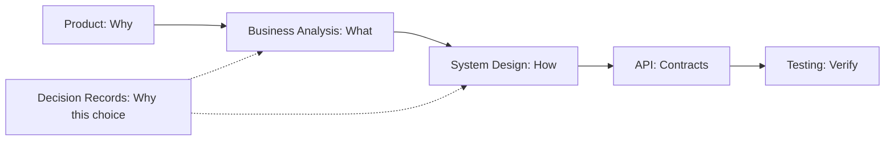

<<<<<<< HEAD
# Plant Care — Documentation Hub

> **Purpose:** One navigation point for product, BA requirements, system design, API, testing and decisions. For **code currently implemented**, begin at the root [README](../README.md) and API overview. `Draft` and `Planned` do not imply deployed behavior.

## Start here



## 01 — Product

- [Product Vision](01-product/product-vision.md) — users, problems, value, product capability status.
- [BACCM Analysis](01-product/baccm-analysis.md) — Change, Need, Solution, Stakeholders, Value, Context.
- [Stakeholder Analysis](01-product/stakeholders.md) — roles, involvement, RACI draft.
- [Roadmap & MVP Scope](01-product/roadmap.md) — suggested feature delivery order.

## 02 — Business Analysis

- [Business Requirements](02-business-analysis/requirements/business-requirements.md) — business outcomes and traceability.
- [Business Rules](02-business-analysis/requirements/business-rules.md) — decisions and task state machine.
- [Non-functional Requirements](02-business-analysis/requirements/non-functional-requirements.md) — qualities, unknown thresholds, review gates.
- [User Journey](02-business-analysis/processes/user-journey.md) — as-is hypothesis, to-be journey, rejection branch.
- [Plant Identification](02-business-analysis/features/plant-identification.md) — existing draft feature/API acceptance requirements.
- [Plant Diagnosis](02-business-analysis/features/plant-diagnosis.md) — existing Diagnose behavior and planned history.
- [Care Planning & Tracking](02-business-analysis/features/care-planning.md) — approved product discovery decisions, planned feature, acceptance criteria.

## 03 — System Design

- [Architecture overview](03-system-design/architecture/system-overview.md)
- [Component design](03-system-design/architecture/component-design.md)
- [HTTP request flow](03-system-design/architecture/request-flow.md)
- [Gemini integration](03-system-design/integrations/gemini-integration.md)
- [Reliability index](03-system-design/reliability/README.md)
- [Failure scenarios](03-system-design/reliability/failure-handling.md)
- [Architecture baseline / historical checkpoint](03-system-design/architecture/architecture-baseline.md)
- `database/` — database design **not yet authored**; do not infer implementation from folder existence.

## 04 — API

- [Existing API overview and error mapping](04-api/api-overview.md) — source-based HTTP endpoints; planned Care APIs excluded.

## 05 — Testing

- [Identify use-case testing workflow](05-testing/test-scenarios.md)
- [Diagnose use-case testing workflow](05-testing/diagnose-usecase-workflow.md)
- [Existing test report](../tests/docs/plant-care-test-report.md)

## 06 — Decisions

- [Architecture Decision Records](06-decisions/README.md)
- [Product Decision Register PD-002–PD-012](06-decisions/product/README.md)

## Reading paths

| Audience | Suggested order |
|---|---|
| Product Owner / BA | Vision → BACCM → Requirements → User Journey → Feature specs → Product decisions |
| Developer | Root README → Architecture → API → Feature specs → ADR → Testing |
| QA / Reviewer | Feature acceptance criteria → Business Rules → API → Testing |
| Portfolio reviewer | Root README → Vision → Architecture → Care Planning (planned) |

## Documentation rules

1. Keep a single canonical home for each concept; link instead of copy-pasting.
2. Mark `Implemented` **only when source evidence exists**; distinguish planned and draft content.
3. Keep future API designs out of current API contracts.
4. Capture evolving work in GitHub Issues/PRs; preserve durable architecture and business knowledge here.
5. For new large features, start with one feature spec file; split into subfolders only as needed.
=======
# Plant Care Backend API

## 1. Mục tiêu

Xây dựng API nhận diện cây trồng (**Identify**) và hỗ trợ chẩn đoán tình trạng cây (**Diagnose**) từ ảnh, sử dụng Node.js, TypeScript, Express, Sharp và Google Gemini.

## 2. API hiện tại

| Endpoint                | Mục đích                               | Đầu vào                               |
| ----------------------- | -------------------------------------- | ------------------------------------- |
| `POST /plants/identify` | Nhận diện và đưa ra thông tin chăm sóc | Một file `image`                      |
| `POST /plants/diagnose` | Phân tích tình trạng và gợi ý xử lý    | Hai file `plantImage`, `diseaseImage` |
| `GET /health`           | Kiểm tra HTTP health endpoint          | Không có ảnh                          |

## 3. Công nghệ và vai trò

- **Node.js + TypeScript + Express:** HTTP application và kiểu dữ liệu.
- **Multer:** Tiếp nhận multipart file upload.
- **Sharp:** Chuẩn hóa ảnh trước khi gửi provider.
- **Google Gemini:** Provider AI bên ngoài.
- **Zod:** Kiểm tra dữ liệu phản hồi tại runtime và cấu hình môi trường theo phần triển khai tương ứng.

## 4. Kiến trúc hiện tại

Một **backend application duy nhất**, có các ranh giới HTTP → Application → Domain và Infrastructure adapters. Đây là mô tả về cách tổ chức code và deployment hiện tại, **không đồng nghĩa** đã áp dụng đầy đủ mọi nguyên tắc Clean Architecture.

Xem [Phân tích kiến trúc hiện tại](docs/architecture/01-current-architecture.md) và [ADR-001](docs/decisions/ADR-001-modular-monolith.md). Toàn bộ chỉ mục tài liệu nằm tại [docs/README.md](docs/README.md).

## 5. Lộ trình phát triển

| Giai đoạn        | Trọng tâm                                 | Trạng thái           |
| ---------------- | ----------------------------------------- | -------------------- |
| ARCH-001         | Kiến trúc hiện trạng, sơ đồ, ADR, nhật ký | Đang thực hiện       |
| Database         | PostgreSQL, schema, migration, index      | Chưa bắt đầu         |
| Reliability      | Timeout, retry, rate limit, lỗi provider  | Chưa đánh giá đầy đủ |
| Async processing | Queue, worker, idempotency                | Chưa bắt đầu         |
| Performance      | Benchmark, p95, throughput, bottleneck    | Chưa bắt đầu         |
| Infrastructure   | Linux, Docker, Nginx, deployment          | Chưa bắt đầu         |
| Scaling          | Scale dọc/ngang, load balancing           | Chưa bắt đầu         |
| Observability    | Logs, metrics, tracing, alerting          | Chưa bắt đầu         |
| Security         | Auth, secret, upload security, backup     | Chưa bắt đầu         |

## 6. Theo dõi quá trình thực hiện

Mỗi checkpoint sử dụng **GitHub Issue → branch → Pull Request → tài liệu → merge**.

- [Nhật ký ARCH-001](docs/journal/001-architecture-baseline.md): Đã làm gì, bằng chứng, vấn đề, bài học.
- [ADR-001](docs/decisions/ADR-001-modular-monolith.md): Vì sao chưa tách microservices.
- Pull Request ghi rõ **What / Why / How / Verification**.

**Nguyên tắc:** Không ghi một thử nghiệm là đã pass nếu chưa thực sự chạy; không tự tạo số liệu tải hoặc kết quả benchmark.

## 7. Chạy và kiểm tra cục bộ

```bash
pnpm install
pnpm typecheck
pnpm lint
pnpm dev
```

Cần cấu hình các biến môi trường mà source code yêu cầu, đặc biệt cấu hình Gemini. **Không commit `.env`, API key hoặc thông tin bí mật.** Kiểm tra tên biến trong `src/config/env.ts` trước khi chạy.

## 8. Cách đọc repository

1. Bắt đầu từ README này.
2. Đọc tài liệu kiến trúc để hiểu request flow.
3. Đọc ADR để hiểu các trade-off.
4. Đọc Engineering Journal và Pull Requests để xem tiến trình học và thực hiện.
>>>>>>> origin/docs
