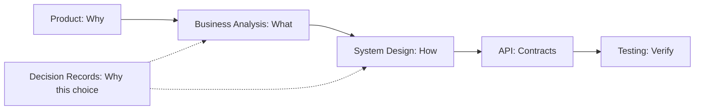

# Plant Care — Documentation Hub

> **Purpose:** One navigation point for product, BA requirements, system design, API, testing and decisions. For **code currently implemented**, begin at the root [README](../README.md) and API overview. `Draft` and `Planned` do not imply deployed behavior.

## Start here

## 01 — Product

- [Product Vision](01-product/product-vision.md) — users, problems, value, product capability status.
- [BACCM Analysis](01-product/baccm-analysis.md) — Change, Need, Solution, Stakeholders, Value, Context.
- [Stakeholder Analysis](01-product/stakeholders.md) — roles, involvement, RACI draft.
- [Roadmap & MVP Scope](01-product/roadmap.md) — suggested feature delivery order.

## 02 — Business Analysis

- [Business Requirements](02-business-analysis/requirements/business-requirements.md) — business outcomes and traceability.
- [Business Rules](02-business-analysis/requirements/business-rules.md) — decisions and task state machine.
- [Non-functional Requirements](02-business-analysis/requirements/non-functional-requirements.md) — qualities, unknown thresholds, review gates.
- [User Journey](02-business-analysis/processes/user-journey.md) — as-is hypothesis, to-be journey, rejection branch.
- [Plant Identification](02-business-analysis/features/plant-identification.md) — existing draft feature/API acceptance requirements.
- [Plant Diagnosis](02-business-analysis/features/plant-diagnosis.md) — existing Diagnose behavior and planned history.
- [Care Planning & Tracking](02-business-analysis/features/care-planning.md) — approved product discovery decisions, planned feature, acceptance criteria.

## 03 — System Design

- [Architecture overview](03-system-design/architecture/system-overview.md)
- [Component design](03-system-design/architecture/component-design.md)
- [HTTP request flow](03-system-design/architecture/request-flow.md)
- [Gemini integration](03-system-design/integrations/gemini-integration.md)
- [Reliability index](03-system-design/reliability/README.md)
- [Failure scenarios](03-system-design/reliability/failure-handling.md)
- [Architecture baseline / historical checkpoint](03-system-design/architecture/architecture-baseline.md)
- `database/` — database design **not yet authored**; do not infer implementation from folder existence.

## 04 — API

- [Existing API overview and error mapping](04-api/api-overview.md) — source-based HTTP endpoints; planned Care APIs excluded.

## 05 — Testing

- [Identify use-case testing workflow](05-testing/test-scenarios.md)
- [Diagnose use-case testing workflow](05-testing/diagnose-usecase-workflow.md)
- [Existing test report](../tests/docs/plant-care-test-report.md)

## 06 — Decisions

- [Architecture Decision Records](06-decisions/README.md)
- [Product Decision Register PD-002–PD-012](06-decisions/product/README.md)

## Reading paths

| Audience | Suggested order |
|---|---|
| Product Owner / BA | Vision → BACCM → Requirements → User Journey → Feature specs → Product decisions |
| Developer | Root README → Architecture → API → Feature specs → ADR → Testing |
| QA / Reviewer | Feature acceptance criteria → Business Rules → API → Testing |
| Portfolio reviewer | Root README → Vision → Architecture → Care Planning (planned) |

## Documentation rules

1. Keep a single canonical home for each concept; link instead of copy-pasting.
2. Mark `Implemented` **only when source evidence exists**; distinguish planned and draft content.
3. Keep future API designs out of current API contracts.
4. Capture evolving work in GitHub Issues/PRs; preserve durable architecture and business knowledge here.
5. For new large features, start with one feature spec file; split into subfolders only as needed.
