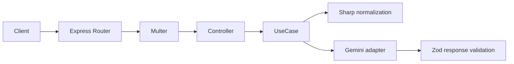

# Plant Care Backend API

> **Project status:** Work in progress. This repository combines existing AI plant-analysis APIs with planned account, plant collection, and care-management features.

## What problem does Plant Care solve?

New plant owners may not know what plant they have, how to care for it, or how to track care over time. Plant Care aims to provide AI-assisted identification and diagnosis, followed by user-controlled plant records and care plans.

## Current vs planned capabilities

| Capability | Status | Evidence / next step |
|---|---|---|
| Plant identification | Implemented API | `POST /plants/identify`; see `docs/04-api/api-overview.md` |
| Plant diagnosis | Implemented API | `POST /plants/diagnose`; see `docs/04-api/api-overview.md` |
| Authentication | Designed, not implemented | Feature FSD and Prisma schema pending |
| My Plants | Planned | Requires authentication and ownership checks |
| Care plan approval and task tracking | Planned | Requirements under review |

**Important:** AI `carePlan` text returned by Identify is not a persisted or approved schedule.

## Architecture at a glance

This diagram represents the existing image-analysis flow, not the planned authentication/database flow.

## API

See [Current API overview](docs/04-api/api-overview.md) for request fields, responses and errors. It distinguishes actual endpoints from future designs.

## Local development

This README does not yet provide verified install/start/test commands. Before publishing setup instructions, check `package.json`, `.env.example`, `compose.yml` and run the commands in a clean environment. Do not guess CLI flags or promise that the database schema has been migrated.

## Documentation

Start at the [Documentation Hub](docs/README.md). Read feature documentation in this order: problem → requirements → design → risks → tests → evidence.

## Implementation integrity

- `Implemented`: corresponding source code exists; tests and runtime evidence must be cited separately.
- `Designed`: reviewed design, but no claim of running code.
- `Planned`: not yet implemented.
- `Draft`: pending review or decision.

## Portfolio review

1. Read [Product Vision](docs/01-product/product-vision.md).
2. Inspect [Current API](docs/04-api/api-overview.md) and source.
3. Review [Architecture](docs/03-system-design/architecture/system-overview.md).
4. Review [Decisions](docs/06-decisions/README.md) and [Testing](docs/05-testing/test-scenarios.md).
