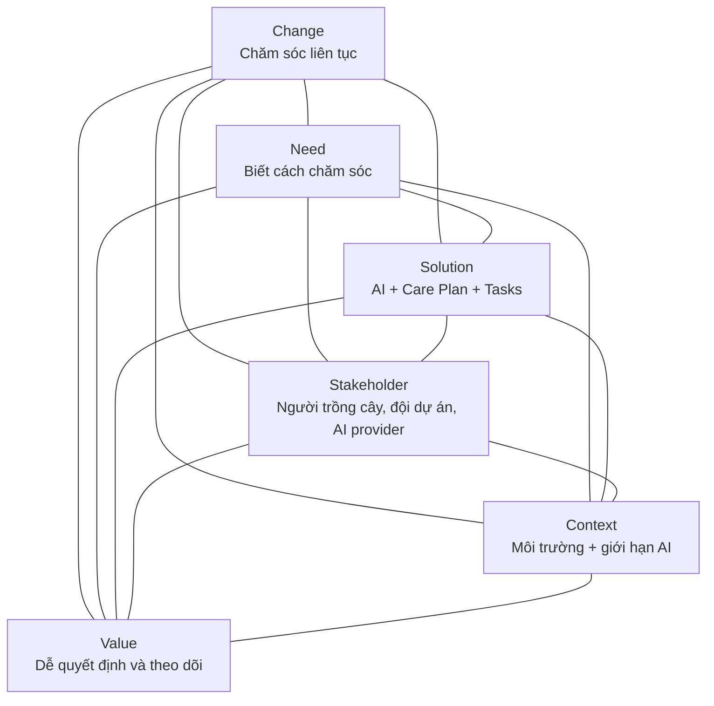

# Plant Care — BACCM Analysis
 
> **Trạng thái:** Bản nháp, thuộc giai đoạn product discovery. Chưa phỏng vấn người dùng và không mô tả hệ thống đã triển khai.
> **Người đọc:** Đội phát triển (BA, Backend, Frontend, QA).
 
## 1. Tóm tắt
 
Plant Care giúp người trồng cây tại nhà chuyển từ **tìm lời khuyên rời rạc** sang **chăm sóc liên tục, có ghi nhận**. Giải pháp dự kiến gồm AI nhận diện và chẩn đoán, danh sách cây của tôi, kế hoạch chăm sóc được người dùng duyệt, công việc và lịch sử chăm sóc.
 
## 2. Sáu khái niệm cốt lõi (BACCM)
 
| Khái niệm | Câu hỏi | Plant Care |
|---|---|---|
| **Need** | Vấn đề cần giải quyết? | Nhận diện cây, hiểu nhu cầu của cây, không quên lịch chăm sóc, xử lý triệu chứng |
| **Stakeholder** | Ai liên quan? | Người trồng cây (người dùng); Product Owner, BA, Developer, QA (đội dự án); AI provider (bên ngoài) |
| **Context** | Bối cảnh và ràng buộc? | Trồng tại nhà hoặc căn hộ; ánh sáng, nước, khí hậu khác nhau; internet và AI không hoàn hảo |
| **Change** | Điều gì sẽ thay đổi? | Từ tìm lời khuyên rời rạc sang quy trình chăm sóc liên tục có ghi nhận |
| **Solution** | Đáp ứng bằng gì? | AI Identify/Diagnose, My Plants, Care Plan được duyệt, Care Task & History |
| **Value** | Mang lại lợi ích gì? | Bớt cảm giác không chắc chắn; theo dõi và quyết định chăm sóc tốt hơn |
 
**Liên hệ:** Người trồng cây có *Need* trong một *Context* cụ thể. *Solution* tạo ra *Change* để đáp ứng Need đó và mang lại *Value*.
 
Sáu khái niệm đều tác động lẫn nhau. Khi một khái niệm thay đổi, cần xem lại năm khái niệm còn lại.
 

 
## 3. Phạm vi MVP
 
Đây là hành vi mong muốn của phần Care Planning & Tracking, chưa phải tính năng đã phát triển.
 
| Có trong MVP | Chưa có trong MVP |
|---|---|
| Người dùng Accept hoặc Reject kế hoạch chăm sóc | Sửa kế hoạch |
| Kế hoạch chỉ được kích hoạt sau khi người dùng duyệt | Tạo lại kế hoạch |
 
Chi tiết và các phần còn lại của phạm vi: xem PD-002 đến PD-012 trong [Product Decisions](../06-decisions/product/README.md).
 
## 4. Giả định cần kiểm chứng
 
Chưa giả định nào được kiểm chứng.
 
| ID | Giả định | Cách kiểm chứng đề xuất |
|---|---|---|
| H-01 | Người mới gặp khó khăn đáng kể khi theo dõi chăm sóc cây; nhắc việc và checklist giải quyết đúng khó khăn thực sự | Phỏng vấn 5–8 người dùng mục tiêu |
| H-02 | Người dùng muốn phê duyệt kế hoạch trước khi kích hoạt | Thử prototype, đo tỷ lệ accept/reject |
| H-03 | Checkbox theo từng công việc dễ dùng hơn nhật ký thủ công | Usability test theo tác vụ |
| H-04 | Chỉ có Accept/Reject mà không sửa hoặc tạo lại có thể gây bế tắc | Đo tỷ lệ từ chối và bỏ dở onboarding |
| H-05 | Người dùng sẵn sàng duy trì việc theo dõi trên ứng dụng | Chưa xác định |
| H-06 | Người dùng tin tưởng kế hoạch AI và hiểu giới hạn của nó | Chưa xác định |
| H-07 | Giải pháp có tác động tích cực đến sức khỏe cây | Chưa xác định (chưa có dữ liệu) |
| H-08 | Thói quen chăm sóc thay đổi theo loài cây và khu vực | Chưa xác định |
 
**Thiếu thông tin:** chưa có phỏng vấn trực tiếp và chưa có thông tin về đối tác chuyên môn.
 
## 5. Tài liệu liên quan
 
- [Product Decisions](../06-decisions/product/README.md): các quyết định về hành vi MVP.
- [Business Requirements](../02-business-analysis/requirements/business-requirements.md): yêu cầu nghiệp vụ.