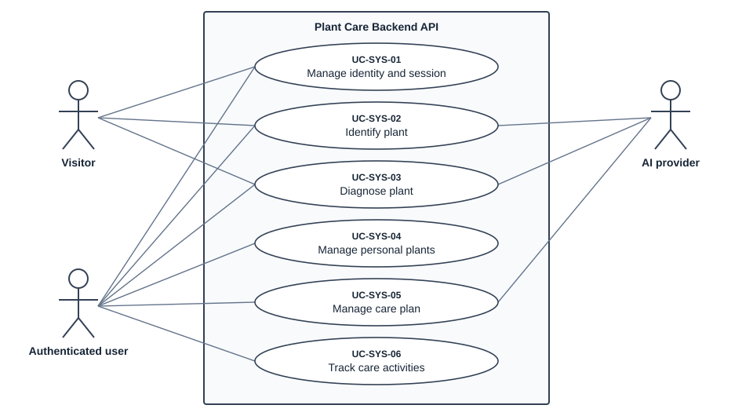

# Plant Care — System Use Case Overview (Level 1)

**Status:** Proposed overview; implementation status varies by capability.  
**Basis:** [Business Requirements](business-requirements.md) · [Roadmap](../01-product/roadmap.md).  
**Maintenance:** [Documentation Standard](../08-guides/documentation-standard.md).

## System boundary and actors

The boundary is Plant Care Backend API. Visitor and authenticated user are external roles; the AI provider is an external supporting system. PostgreSQL is internal infrastructure, not an actor at this boundary. Client applications mediate user interactions.

## Capability catalog and decomposition

| ID | Goal | Business outcome | Status / next document |
|---|---|---|---|
| UC-SYS-01 | Manage identity and session | BR-02 | Accepted auth policy; implementation in progress — [Level 2 & 3](../03-features/authentication/use-cases.md) |
| UC-SYS-02 | Identify plant | BR-01 | API implemented; [requirements](features/plant-identification.md) |
| UC-SYS-03 | Diagnose plant | BR-05 | API implemented; [requirements](features/plant-diagnosis.md) |
| UC-SYS-04 | Manage personal plants | BR-02 | Planned; ownership boundary in [UC-AUTH-06](../03-features/authentication/use-cases.md#uc-auth-06--my-plants-ownership-boundary) |
| UC-SYS-05 | Manage care plan | BR-03 | Planned; [requirements](features/care-planning.md) |
| UC-SYS-06 | Track care activities | BR-04 | Planned; [requirements](features/care-planning.md) |

The planned AI care-plan integration is a roadmap assumption, not verified implementation. Identify/Diagnose remain public in the authentication MVP. OAuth, MFA, password reset and global logout are outside its scope. Push notifications and replanning are not committed MVP capabilities.

## Change control

Review this catalog and diagram first; update affected feature decomposition, detailed specifications, FSD, design and tests in the same change. Preserve IDs; do not renumber existing cases. No diagram change is required when the system scope and associations are unchanged.

The diagram is stored as a local SVG asset. Update the SVG together with this catalog whenever actors, use cases or associations change.
