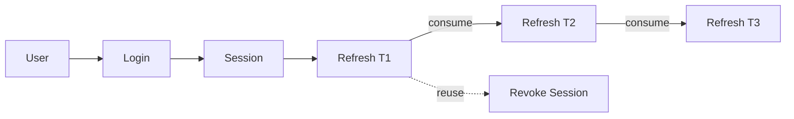

# Authentication — Feature Hub

**Status:** Designed / not implemented. **Last reviewed:** 2026-11-23. **Related outcome:** BR-02, personal plant collection and ownership.

## Start here

| Read in order | Question answered | Artifact |
|---|---|---|
| 1 | What must the feature do? | [FSD](fsd.md) |
| 2 | How does a user/system interact? | [Use cases](use-cases.md) |
| 3 | Why this architecture? | [Design](design.md) |
| 4 | What can go wrong? | [Risk analysis](risks.md) |
| 5 | How can we prove it? | [Test cases](test-cases.md) |
| 6 | What did we learn from failures? | [Troubleshooting](troubleshooting.md) |

## Feature in 30 seconds

A registered user logs in and receives a short-lived access credential and a refresh token. A login creates one Session. Each successful refresh consumes the old RefreshToken and inserts a new record in the same Session. Reuse of a consumed token triggers **strict** session revocation (a security policy with known false-positive risk). Logout revokes the Session. My Plants ownership must derive from authenticated identity, never client-provided `ownerId`.

## Implementation truth

- Current `main` contains working Identify/Diagnose endpoints, but this proposed authentication feature is **not yet implemented**.
- Current checked-in Prisma contract contains sample `User/Post`; it is not evidence that these models have been migrated.
- The FSD is a draft; test cases below are **not executed**.

## What you must be able to explain

1. Why separate Session from RefreshToken?
2. Why distinguish `consumedAt` and `revokedAt`?
3. Why use `parentTokenId` rather than `parentHash`?
4. Why is a database transaction insufficient by itself to prevent concurrent rotation?
5. What legitimate behavior can strict reuse detection incorrectly classify as an attack?
6. Which integration test would falsify the design?

**Before coding:** resolve client transport/CSRF, session/access-token invalidation semantics, TTL and retention, and PostgreSQL locking strategy. Record the final decisions in ADRs.
