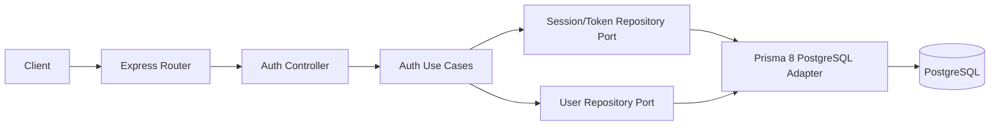
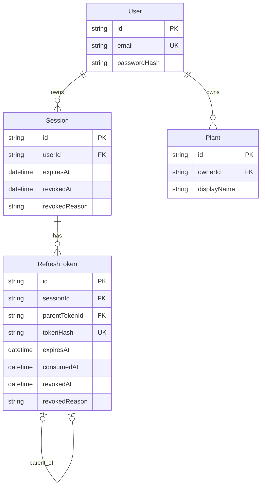
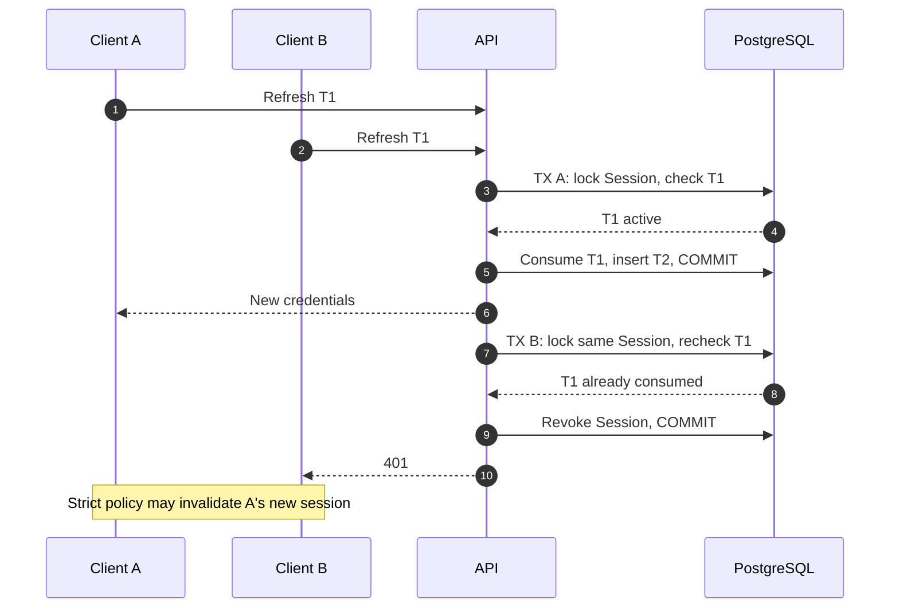

# Authentication — Technical Design and Trade-offs

**Status:** Proposed, unverified with Prisma 8 RC runtime. **Source baseline:** current GitHub `authentication-design.md`, `prisma-schema-design.md`, and [FSD](fsd.md).

## 1. Architecture boundary

**Controller:** transport/validation and status mapping. **Use Case:** rotation rules and outcomes. **Repository adapter:** transactions, locking, persistence. Avoid exposing Prisma models as HTTP contracts.

## 2. Data ownership and invariants

- `Session` is one login context; its ID remains stable through refreshes.
- `RefreshToken` is one credential generation. `consumedAt` records successful rotation; `revokedAt` records explicit invalidation; expiry is computed from `expiresAt`.
- `parentTokenId` references prior token ID. `UNIQUE(parentTokenId)` prevents two successor rows for one parent (subject to DB semantics for NULL). A foreign key alone **does not** guarantee parent and child share `sessionId`.
- Protect the same-session invariant in a serialized transaction and test it; consider a composite FK `(parentTokenId, sessionId) → (id, sessionId)` with a suitable composite unique key if supported by the final Prisma 8 contract/migration.
- A token can be consumed and later revoked during incident handling. `revokedReason` is controlled by domain validation, not arbitrary client input.
- A deterministic verifier such as HMAC-SHA-256 keyed with a separate server secret can index random high-entropy refresh tokens; rotate verifier keys carefully. Passwords require a password-specific hash (e.g. Argon2id), not this verifier scheme.

## 3. Refresh transaction and concurrency

**Design obligation:** Both successful rotation and reuse revocation must serialize against the same Session row (or use a proven equivalent). A transaction without a lock/conditional write is not enough. Under `READ COMMITTED`, acquire a row lock before evaluating current state, then re-read the token and Session; enforce conditional consume and successor uniqueness. Prisma 8 RC may require an adapter/raw SQL mechanism; verify actual API and integration tests before committing implementation.

**Security limitation:** A repeated bearer token does not reveal whether it came from attacker or legitimate retry. A grace window may reduce false positives but can weaken theft response. MVP proposal: strict policy and client-side single-flight refresh, with explicit UX cost.

## 4. Alternatives and why

| Decision | Option A | Option B | Proposed reason |
|---|---|---|---|
| Credential lineage | `parentHash` | `parentTokenId` | ID relation avoids coupling to hash format and supports FK |
| Session model | New Session each refresh | Stable Session + new RefreshToken | Preserves device/login identity and audit history |
| Token lifecycle | `revokedReason=ROTATION` | Separate `consumedAt` | Consumption is not revocation |
| Reuse policy | Grace period | Strict revoke affected Session | Stronger theft response, but duplicate-request false positives |
| Concurrent control | Transaction only | Session lock + conditional consume + unique successor | Prevents double issue and revoke/issue race |
| Logout enforcement | Check Session on every protected API | Allow access JWT until short TTL | Performance vs immediate revocation; **not decided** |

## 5. Failure modes and recovery

- **Insert T2 fails:** Roll back consume of T1. Never return success before commit.
- **DB unavailable:** Fail closed; no new credential; log correlation ID without raw token.
- **Response lost after commit:** Client may retry T1 and trigger strict reuse; this is a known usability cost requiring product review.
- **Concurrent logout and refresh:** Both lock Session; no token should become usable after Session revocation.
- **Expired Session:** No refresh, even when latest token is unexpired.
- **Verifier key rotation:** Old token hashes may become unresolvable; plan multi-key verification or deliberate session invalidation.

## 6. Unresolved decisions before production

Client platform and refresh transport; CSRF protection; TTLs and absolute/idle expiry; session revocation impact on access JWT; password policy; token history retention; incident audit and rate limits; exact PostgreSQL/Prisma 8 RC locking implementation; 401/403/404 API envelope.

## 7. Implementation order

(1) Resolve blocking decisions → (2) validate Prisma 8 Contract with `pnpm exec prisma contract emit` → (3) inspect and replace **pending sample User/Post migration**, without applying it → (4) run migration on disposable dev DB after explicit data-safety review → (5) implement Register/Login → (6) Refresh/Logout → (7) integration tests with real PostgreSQL → (8) connect My Plants authorization.

**Do not assume:** `@default(uuid())` works in Prisma 8 RC. The user's CLI explicitly requires `@onCreate(uuid())` for client-generated UUID. No schema in this document has been executed.
