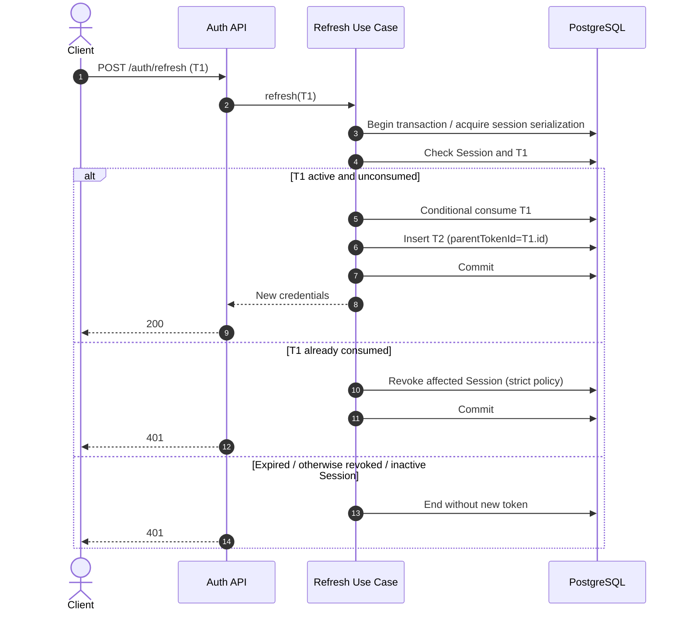
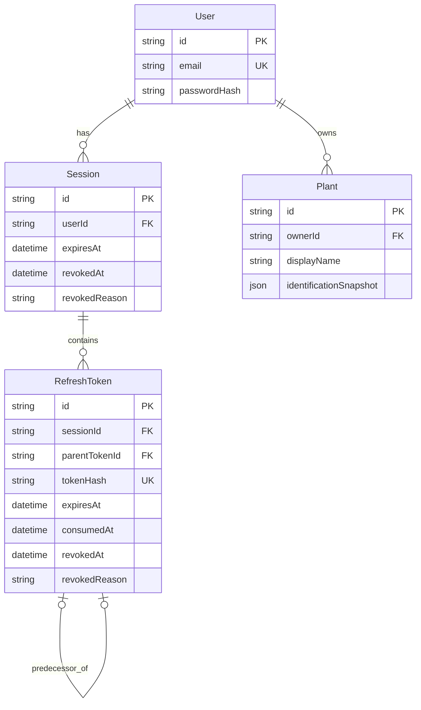

# Plant Care — Authentication Functional Specification (FSD v1)

**Status:** Proposed MVP specification — owner approval required before coding; not implemented.  
**Scope:** Identity & session lifecycle, including refresh-token rotation and reuse detection.  
**Normative after approval:** This FSD defines behavior; `design.md` defines architecture; `use-cases.md` details flows; `test-cases.md` defines verification. Change these existing files when a decision changes.  
**Traceability:** Business goal BR-02 (personal plant collection) requires authenticated ownership.

## 1. Business context and objective

A user needs to return to their saved plants across visits without exposing another user's data. Authentication provides an identity and securely managed login sessions. This document describes expected behavior; it is not proof of implementation.

### In scope
- Register with email/password; login; refresh; logout current session; get current user.
- Multiple sessions per user, one refresh-token lineage per session.
- Rotation creates a **new RefreshToken row**; session identity stays stable.
- Strict detection of reuse of a consumed refresh token; revoke affected session.
- Secure storage of password hashes and refresh-token hashes; authorization boundary for My Plants.

### Out of scope (MVP)
- OAuth, MFA, email verification, password reset, global logout, admin user management.
- Full Care Planning, push notifications, and AI identification access-policy changes.

## 2. Actors and system boundary

- **Visitor:** registers or logs in.
- **Authenticated user:** reads own profile, refreshes credentials, logs out, manages own plants.
- **Authentication API:** validates requests and enforces policies.
- **PostgreSQL:** stores user, session, and refresh-token records.
- **Client:** sends bearer access JWT and opaque refresh token as specified in section 8.

## 3. Functional requirements

| ID | Requirement | Priority | Verification |
|---|---|---|---|
| FR-AUTH-01 | Register a unique normalized email with a securely hashed password. | Must | TC-AUTH-01 |
| FR-AUTH-02 | Reject invalid login without creating a session. | Must | TC-AUTH-02 |
| FR-AUTH-03 | Successful login creates one Session and its initial RefreshToken. | Must | TC-AUTH-03 |
| FR-AUTH-04 | Valid refresh consumes the presented token exactly once and creates a successor in the same Session. | Must | TC-AUTH-04 |
| FR-AUTH-05 | Successor token records `parentTokenId` referring to its predecessor; each parent has at most one successor. | Must | TC-AUTH-05 |
| FR-AUTH-06 | A previously consumed token is rejected; under strict policy the affected Session is revoked. | Must | TC-AUTH-06 |
| FR-AUTH-07 | Expired/revoked token or expired/revoked Session cannot refresh. | Must | TC-AUTH-07 |
| FR-AUTH-08 | Logout revokes current Session and prevents subsequent refresh on it. | Must | TC-AUTH-08 |
| FR-AUTH-09 | At most one concurrent refresh request can successfully consume a given token. | Must | TC-AUTH-09 |
| FR-AUTH-10 | Rotation is atomic: failed successor creation must not leave predecessor consumed. | Must | TC-AUTH-10 |
| FR-AUTH-11 | Password and raw refresh token are never stored in database or application logs. | Must | TC-AUTH-11 |
| FR-AUTH-12 | Authenticated My Plants operations use server-verified user identity for ownership. | Must | TC-AUTH-12 |

## 4. Business/security rules

| ID | Rule |
|---|---|
| BR-AUTH-01 | `consumedAt` records successful use in rotation; `revokedAt` records administrative/security invalidation. These are distinct events. |
| BR-AUTH-02 | `revokedReason` applies to revocation, e.g. `LOGOUT`, `ADMIN_REVOKED`, `REUSE_DETECTED`, `SECURITY_POLICY`; rotation itself is not a revocation reason. |
| BR-AUTH-03 | Reuse means presenting a token already marked consumed. Strict policy revokes the **affected Session**, not automatically all sessions belonging to the user. |
| BR-AUTH-04 | A token revoked for a different reason is denied without automatically classifying the attempt as consumed-token reuse. |
| BR-AUTH-05 | A refresh token is a high-entropy random secret; persist only a deterministic, cryptographically secure verifier/hash, never the raw token. |
| BR-AUTH-06 | A new token's parent must belong to the same Session. A unique nullable `parentTokenId` helps prevent forks; the same-session invariant requires additional enforcement. |
| BR-AUTH-07 | Expiration is determined by `expiresAt`; it does not require mutating the token on every read. |
| BR-AUTH-08 | Strict reuse detection may log out legitimate clients after duplicate requests; the client should serialize refresh attempts. |

## 5. Use cases

### UC-AUTH-01 — Register
**Precondition:** A valid email and password are supplied; uniqueness is enforced during persistence.  
**Main flow:** Visitor submits valid email/password → system normalizes and validates input → securely hashes password → persists User → returns registration success.  
**Alternatives:** Duplicate email or invalid input → reject without creating a User.  
**Postcondition:** User exists; registration does not automatically log in.

### UC-AUTH-02 — Login
**Precondition:** Registered User exists.  
**Main flow:** User submits credentials → system verifies password → creates Session and first RefreshToken atomically → issues access and refresh credentials.  
**Alternatives:** Invalid credentials → generic authentication failure; no Session created.  
**Postcondition:** One active Session with initial unconsumed RefreshToken.

### UC-AUTH-03 — Refresh access credentials
**Precondition:** Refresh token is authentic, unexpired, unconsumed, unrevoked, and belongs to an active Session.  
**Main flow:** Client submits token T1 → system validates token and Session → atomically marks T1 consumed and creates T2 with `parentTokenId = T1.id` → commits → returns new credentials.  
**Alternative A:** T1 already consumed → reject and revoke affected Session under strict policy.  
**Alternative B:** Token expired, revoked for another reason, or Session inactive → reject; do not create a successor.  
**Exception:** Database write fails → rollback rotation; do not claim success.  
**Postcondition:** At most one valid successor per token, and session remains stable on successful rotation.

### UC-AUTH-04 — Logout
**Precondition:** Current Session can be identified securely.  
**Main flow:** User requests logout → system revokes Session → subsequent refresh attempts on that Session fail.  
**Postcondition:** Session invalid for refresh; protected requests reject the revoked Session on subsequent validation (section 8.2).

## 6. UML — Rotation and reuse

**Concurrency requirement:** The entire check/consume/insert/reuse-revocation flow must serialize on the relevant Session (or use an equivalent correct concurrency strategy). A transaction alone is insufficient without suitable locking/conditional writes and constraints. The implementation must ensure a reuse revocation cannot race with issuance of a still-valid successor. Do not return a successor token to an unauthenticated duplicate request as a grace-period workaround.

## 7. ERD (conceptual)

### Constraints and data semantics
- `User.email` unique after agreed normalization.
- `RefreshToken.tokenHash` unique; `parentTokenId` nullable and unique.
- Session remains constant across rotations; RefreshToken rows are append-only except for lifecycle fields such as `consumedAt`/`revokedAt`.
- Ensure token-parent relationship belongs to same Session, either by database constraint design or transactionally enforced invariant with tests.
- `createdAt` for audit. `updatedAt` on RefreshToken is not required unless a specific requirement emerges.
- Historical tokens require a retention and purge policy; snapshots are not database backups.

## 8. MVP API and security policy (proposed for approval)

These are **specific proposed choices**, not implemented facts. Once approved, they become the acceptance baseline. Changing one requires updating this FSD and affected tests, not creating a comparison document.

### 8.1 Client and credential transport

- MVP target: HTTP API consumed by a trusted test client or mobile-style client. Access token is a JWT in `Authorization: Bearer <token>`; refresh token is an opaque random credential sent in the JSON request body.
- No refresh cookie in this MVP. Consequently cookie-specific CSRF handling is not part of this MVP; **never interpret this as CSRF protection for a future cookie-based browser client**.
- The client must store refresh tokens in an appropriate secure credential store. Avoid localStorage for a browser production client. The API must never log credentials.
- Access JWT includes `sub` (user ID), `sid` (Session ID), `iat`, `exp`; signature, issuer and audience are verified. Signing secret is separate from refresh verifier key.

### 8.2 Lifetimes and revocation

- Access JWT TTL: **15 minutes**. Refresh token TTL: **7 days per issued token**. Session absolute TTL: **30 days from login**, not extended by rotation.
- **Idle timeout:** a Session expires after an inactivity interval, independently of its absolute expiry. Proposed MVP default: **24 hours** (requires owner approval). Store `lastActivityAt` and define `idleExpiresAt = lastActivityAt + idleTimeout`; a Session is active only when `now < expiresAt` **and** `now < idleExpiresAt` and `revokedAt IS NULL`.
- **Activity definition:** a successful authenticated protected API request or successful refresh counts as activity. Update `lastActivityAt` atomically/monotonically (never move backwards); do not extend `expiresAt`. Rejected requests, invalid tokens and background cleanup do not count. At the expiry boundary (`now >= idleExpiresAt`), deny access and refresh with `401`. Use a trusted server/DB clock and test boundary and concurrent updates. This per-request write is an MVP trade-off; optimize only after correctness tests.
- Protected API endpoints verify JWT signature/claims and the referenced Session's active status. Thus logout/reuse revocation takes effect on subsequent protected requests (subject to in-flight requests). This costs a database read; no cache in the MVP.
- Refresh uses the earlier of its own expiry and Session expiry. Strict reuse of a consumed token revokes only the affected Session.
- Retain consumed/revoked token rows while their Session is retained. A retention/deletion job is **not part of the MVP**; do not claim production-grade retention compliance until a policy and job exist.

### 8.3 Registration, login and logout behavior

- Normalize email with `trim().toLowerCase()`; enforce uniqueness on the normalized value. Password minimum 12 characters; reject excessively long input (e.g. over 128 characters). Hash with Argon2id using a maintained library and documented parameters.
- Registration does **not** automatically log in. Login creates a new Session and first RefreshToken in one transaction.
- Logout requires a valid access JWT and revokes its `sid` Session; repeated logout using the same now-revoked JWT returns `401` under Session validation. Logout does not revoke other Sessions.
- **Client contract:** `401` on a repeated logout with a revoked/expired Session is **expected behavior, not a server bug**. Client clears local access token, refresh token, user state and session state; treats logout as complete and **does not display an error notification**. Do not treat arbitrary `401` from other endpoints as a successful logout without checking the request context.
- Identify/Diagnose endpoints remain public in this phase; My Plants endpoints require authentication.

### 8.4 Endpoint contract

| Method | Endpoint | Request | Success |
|---|---|---|---|
| POST | `/auth/register` | `{ "email": "...", "password": "..." }` | `201` with `{ "id": "...", "email": "..." }` |
| POST | `/auth/login` | `{ "email": "...", "password": "..." }` | `200` with `{ "accessToken": "...", "refreshToken": "...", "tokenType": "Bearer", "expiresIn": 900 }` |
| POST | `/auth/refresh` | `{ "refreshToken": "..." }` | `200` with same credential envelope as login |
| POST | `/auth/logout` | Bearer access token | `204`, no body |
| GET | `/auth/me` | Bearer access token | `200` with `{ "id": "...", "email": "..." }` |

Errors use `{ "error": { "code": "MACHINE_READABLE", "message": "Safe message" } }`. `400` for malformed inputs, `401` for invalid credentials/tokens/session, `409` for duplicate email, `429` for rate limiting when the limiter is implemented, `500` for unexpected errors. A production release must not claim brute-force protection without rate-limit tests. Do not expose whether an email exists in the **login** response. Register duplicate `409` is an explicit product trade-off.

### 8.5 Concurrency and database invariants

- All Session lifecycle operations (rotation, reuse revocation, logout) serialize on the same Session row in PostgreSQL, then re-read state under lock. A plain transaction without locking is insufficient.
- A conditional consume operation and unique `parentTokenId` guarantee at most one successor. **Composite FK is the required database defense** for same-Session lineage: `(parentTokenId, sessionId)` references a unique `(id, sessionId)` on `RefreshToken`, while `parentTokenId` remains unique. Inspect generated SQL and verify actual PostgreSQL constraints. If the Prisma 8 RC migration cannot express this, use reviewed migration SQL rather than silently weakening the invariant.
- **Prisma Client join behavior with a composite FK is NOT VERIFIED.** Before trusting the relation include/join result, run an integration test using real PostgreSQL: create Session A and B; create parent P in A; create valid child C in A; fetch C with its parent via Prisma Client; assert `C.sessionId === A.id`, `C.parentTokenId === P.id`, `C.parent.id === P.id`, and `C.parent.sessionId === A.id`. Fail immediately on mismatch. Also attempt a child in B pointing to P in A and assert PostgreSQL rejects it. Do not mark this verified until the test actually passes.
- Raw refresh token is never persisted. Only a keyed cryptographic verifier is persisted; keep its secret separate from JWT signing secret.
- **Implementation gate:** Prisma 8 RC contract emit, generated migration inspection, isolated DB application and PostgreSQL concurrency tests must pass before declaring implementation complete.

## 9. Test cases (draft)

| ID | Given / When | Expected |
|---|---|---|
| TC-AUTH-01 | Register unique email / duplicate email | One user created / duplicate rejected |
| TC-AUTH-02 | Wrong password | Authentication rejected; no Session |
| TC-AUTH-03 | Valid login | Session and initial RefreshToken persisted |
| TC-AUTH-04 | Refresh T1 once | T1 consumed; T2 created; same Session |
| TC-AUTH-05 | T1 → T2 → T3 | Correct parent lineage; no forks |
| TC-AUTH-06 | Reuse T1 after rotation | 401; affected Session revoked |
| TC-AUTH-07 | Expired/revoked token or Session | 401; no successor |
| TC-AUTH-08 | Logout then refresh | Refresh denied |
| TC-AUTH-23 | Repeat logout using revoked access JWT | 401; client silently clears local auth state |
| TC-AUTH-25 | Session idle timeout boundary | 401 for protected API and refresh at/after idle expiry |
| TC-AUTH-26 | Prisma composite FK parent include | Correct parent returned from Session A; cross-session FK insert rejected |
| TC-AUTH-09 | Two simultaneous refreshes of T1 | At most one success; strict policy may revoke Session |
| TC-AUTH-10 | Fail insert T2 after consuming T1 | Transaction rollback; no partial rotation |
| TC-AUTH-11 | Inspect persisted records and logs | No raw password/refresh token |
| TC-AUTH-12 | User A requests User B's plant | Access denied/no cross-user data |

**Testing layers:** Domain/unit tests for state rules; PostgreSQL integration tests for transactions/constraints/races; API tests for status and credentials; UAT for business-visible login, return visit, and logout. Race/security checks are not substituted by UAT.

## 10. UAT scenarios (business-visible)

| ID | Scenario | Acceptance evidence |
|---|---|---|
| UAT-AUTH-01 | User registers, logs in, saves a plant, and returns later | Own plant remains accessible |
| UAT-AUTH-02 | User logs out and attempts to refresh | Cannot obtain new access credentials |
| UAT-AUTH-03 | User signs in from two devices and logs out one | Other device remains active, subject to chosen session policy |

**UAT status:** Not executed. No stakeholder sign-off.

## 11. Approval gate

The policies in section 8 are proposed defaults, including the proposed 24-hour idle timeout. The owner must approve or edit them before implementation. In particular, confirm: (1) mobile-style JSON token transport vs browser cookies; (2) immediate Session check for every protected request; (3) 15-minute / 7-day / 30-day lifetimes; (4) strict reuse revocation. After approval, there should be no unresolved `TBD` affecting MVP behavior.

## 12. Implementation and migration checklist

- [ ] Treat this approved FSD and its linked feature docs as the canonical requirements; remove stale links when consolidating old documentation.
- [ ] Review and update Prisma 8 `contract.prisma`; verify with `pnpm exec prisma contract emit`.
- [ ] Inspect pending migration `20261122T1655_init_identity_plants` against the approved model before any apply; do not assume it matches the current Contract.
- [ ] Inspect local dev DB and explicitly confirm volume reset scope before deleting anything.
- [ ] Generate a fresh migration from the validated contract, inspect `migration.ts` and `ops.json`, then apply to disposable development DB.
- [ ] Verify DB marker/schema and migration status; test constraints.
- [ ] Implement Register → Login → Refresh → Logout → My Plants as vertical slices.
- [ ] Commit specs, migration, code and test evidence; do not claim completion without passing checks.

## 13. Traceability and document status

- Business Requirements: `docs/02-business-analysis/requirements/business-requirements.md` (BR-02).
- Existing auth design: `docs/03-system-design/security/authentication-design.md` (to be revised).
- Existing DB design: `docs/03-system-design/database/prisma-schema-design.md` (to be revised).
- **This file is a proposed FSD, not yet committed to GitHub.**
