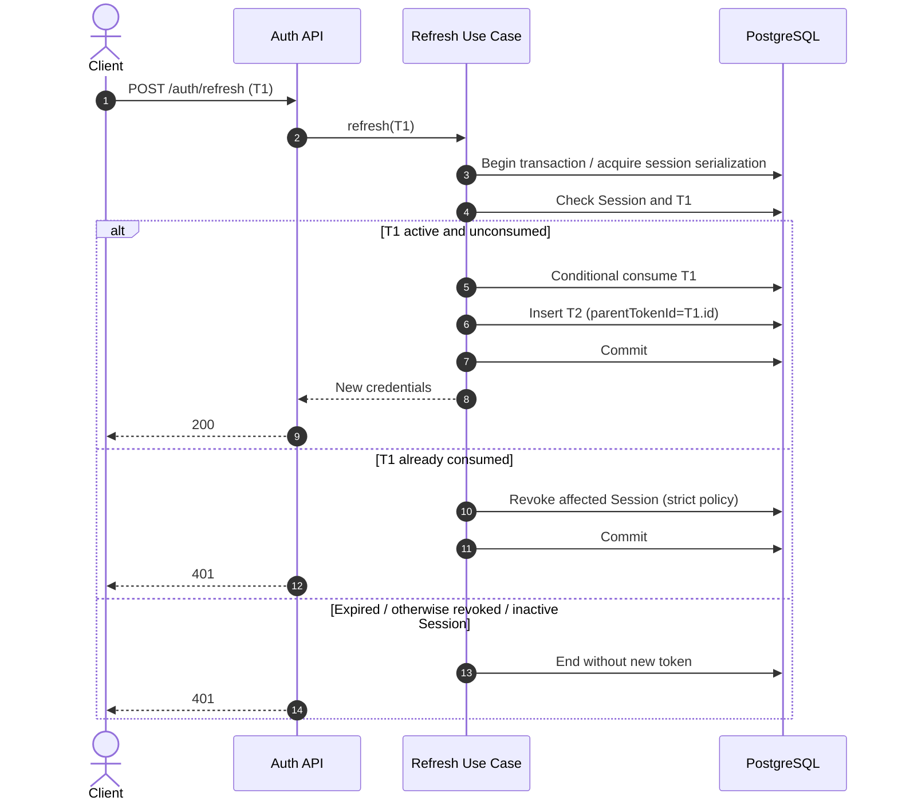

# Plant Care — Authentication Functional Specification (FSD v1)

**Status:** Draft for technical review; not implemented or UAT-approved.  
**Scope:** Identity & session lifecycle, including refresh-token rotation and reuse detection.  
**Source baseline:** Existing `docs/03-system-design/security/authentication-design.md` and `docs/03-system-design/database/prisma-schema-design.md` on GitHub, plus decisions agreed in this conversation.  
**Traceability:** Business goal BR-02 (personal plant collection) requires authenticated ownership.

## 1. Business context and objective

A user needs to return to their saved plants across visits without exposing another user's data. Authentication provides an identity and securely managed login sessions. This document describes expected behavior; it is not proof of implementation.

### In scope
- Register with email/password; login; refresh; logout current session; get current user.
- Multiple sessions per user, one refresh-token lineage per session.
- Rotation creates a **new RefreshToken row**; session identity stays stable.
- Strict detection of reuse of a consumed refresh token; revoke affected session.
- Secure storage of password hashes and refresh-token hashes; authorization boundary for My Plants.

### Out of scope (MVP)
- OAuth, MFA, email verification, password reset, global logout, admin user management.
- Full Care Planning, push notifications, and AI identification access-policy changes.

## 2. Actors and system boundary

- **Visitor:** registers or logs in.
- **Authenticated user:** reads own profile, refreshes credentials, logs out, manages own plants.
- **Authentication API:** validates requests and enforces policies.
- **PostgreSQL:** stores user, session, and refresh-token records.
- **Client:** stores and sends credentials according to a policy still to be selected.

## 3. Functional requirements

| ID | Requirement | Priority | Verification |
|---|---|---|---|
| FR-AUTH-01 | Register a unique normalized email with a securely hashed password. | Must | TC-AUTH-01 |
| FR-AUTH-02 | Reject invalid login without creating a session. | Must | TC-AUTH-02 |
| FR-AUTH-03 | Successful login creates one Session and its initial RefreshToken. | Must | TC-AUTH-03 |
| FR-AUTH-04 | Valid refresh consumes the presented token exactly once and creates a successor in the same Session. | Must | TC-AUTH-04 |
| FR-AUTH-05 | Successor token records `parentTokenId` referring to its predecessor; each parent has at most one successor. | Must | TC-AUTH-05 |
| FR-AUTH-06 | A previously consumed token is rejected; under strict policy the affected Session is revoked. | Must | TC-AUTH-06 |
| FR-AUTH-07 | Expired/revoked token or expired/revoked Session cannot refresh. | Must | TC-AUTH-07 |
| FR-AUTH-08 | Logout revokes current Session and prevents subsequent refresh on it. | Must | TC-AUTH-08 |
| FR-AUTH-09 | At most one concurrent refresh request can successfully consume a given token. | Must | TC-AUTH-09 |
| FR-AUTH-10 | Rotation is atomic: failed successor creation must not leave predecessor consumed. | Must | TC-AUTH-10 |
| FR-AUTH-11 | Password and raw refresh token are never stored in database or application logs. | Must | TC-AUTH-11 |
| FR-AUTH-12 | Authenticated My Plants operations use server-verified user identity for ownership. | Must | TC-AUTH-12 |

## 4. Business/security rules

| ID | Rule |
|---|---|
| BR-AUTH-01 | `consumedAt` records successful use in rotation; `revokedAt` records administrative/security invalidation. These are distinct events. |
| BR-AUTH-02 | `revokedReason` applies to revocation, e.g. `LOGOUT`, `ADMIN_REVOKED`, `REUSE_DETECTED`, `SECURITY_POLICY`; rotation itself is not a revocation reason. |
| BR-AUTH-03 | Reuse means presenting a token already marked consumed. Strict policy revokes the **affected Session**, not automatically all sessions belonging to the user. |
| BR-AUTH-04 | A token revoked for a different reason is denied without automatically classifying the attempt as consumed-token reuse. |
| BR-AUTH-05 | A refresh token is a high-entropy random secret; persist only a deterministic, cryptographically secure verifier/hash, never the raw token. |
| BR-AUTH-06 | A new token's parent must belong to the same Session. A unique nullable `parentTokenId` helps prevent forks; the same-session invariant requires additional enforcement. |
| BR-AUTH-07 | Expiration is determined by `expiresAt`; it does not require mutating the token on every read. |
| BR-AUTH-08 | Strict reuse detection may log out legitimate clients after duplicate requests; the client should serialize refresh attempts. |

## 5. Use cases

### UC-AUTH-01 — Register
**Precondition:** Email is not already registered.  
**Main flow:** Visitor submits valid email/password → system normalizes and validates input → securely hashes password → persists User → returns registration success.  
**Alternatives:** Duplicate email or invalid input → reject without creating a User.  
**Postcondition:** User exists; automatic login after registration remains an open product decision.

### UC-AUTH-02 — Login
**Precondition:** Registered User exists.  
**Main flow:** User submits credentials → system verifies password → creates Session and first RefreshToken atomically → issues access and refresh credentials.  
**Alternatives:** Invalid credentials → generic authentication failure; no Session created.  
**Postcondition:** One active Session with initial unconsumed RefreshToken.

### UC-AUTH-03 — Refresh access credentials
**Precondition:** Refresh token is authentic, unexpired, unconsumed, unrevoked, and belongs to an active Session.  
**Main flow:** Client submits token T1 → system validates token and Session → atomically marks T1 consumed and creates T2 with `parentTokenId = T1.id` → commits → returns new credentials.  
**Alternative A:** T1 already consumed → reject and revoke affected Session under strict policy.  
**Alternative B:** Token expired, revoked for another reason, or Session inactive → reject; do not create a successor.  
**Exception:** Database write fails → rollback rotation; do not claim success.  
**Postcondition:** At most one valid successor per token, and session remains stable on successful rotation.

### UC-AUTH-04 — Logout
**Precondition:** Current Session can be identified securely.  
**Main flow:** User requests logout → system revokes Session → subsequent refresh attempts on that Session fail.  
**Postcondition:** Session invalid for refresh; whether already-issued access tokens are rejected immediately is an open decision.

## 6. UML — Rotation and reuse



**Concurrency requirement:** The entire check/consume/insert/reuse-revocation flow must serialize on the relevant Session (or use an equivalent correct concurrency strategy). A transaction alone is insufficient without suitable locking/conditional writes and constraints. The implementation must ensure a reuse revocation cannot race with issuance of a still-valid successor. Do not return a successor token to an unauthenticated duplicate request as a grace-period workaround.

## 7. ERD (conceptual)

```mermaid
erDiagram
    User ||--o{ Session : has
    User ||--o{ Plant : owns
    Session ||--o{ RefreshToken : contains
    RefreshToken o|--o| RefreshToken : predecessor_of
    User { string id PK; string email UK; string passwordHash }
    Session { string id PK; string userId FK; datetime expiresAt; datetime revokedAt; string revokedReason }
    RefreshToken { string id PK; string sessionId FK; string parentTokenId FK; string tokenHash UK; datetime expiresAt; datetime consumedAt; datetime revokedAt; string revokedReason }
    Plant { string id PK; string ownerId FK; string displayName; json identificationSnapshot }
```

### Constraints and data semantics
- `User.email` unique after agreed normalization.
- `RefreshToken.tokenHash` unique; `parentTokenId` nullable and unique.
- Session remains constant across rotations; RefreshToken rows are append-only except for lifecycle fields such as `consumedAt`/`revokedAt`.
- Ensure token-parent relationship belongs to same Session, either by database constraint design or transactionally enforced invariant with tests.
- `createdAt` for audit. `updatedAt` on RefreshToken is not required unless a specific requirement emerges.
- Historical tokens require a retention and purge policy; snapshots are not database backups.

## 8. API contracts (provisional)

| Method | Endpoint | Success | Notes |
|---|---|---|---|
| POST | `/auth/register` | 201 | Request/response schema TBD |
| POST | `/auth/login` | 200 | Creates Session + initial token |
| POST | `/auth/refresh` | 200 | Rotates token, strict reuse detection |
| POST | `/auth/logout` | 204 | Revokes current Session |
| GET | `/auth/me` | 200 | Requires valid access credential |

401/400/409/429 and error envelope need a separate API-contract decision; do not assume endpoints already exist.

## 9. Test cases (draft)

| ID | Given / When | Expected |
|---|---|---|
| TC-AUTH-01 | Register unique email / duplicate email | One user created / duplicate rejected |
| TC-AUTH-02 | Wrong password | Authentication rejected; no Session |
| TC-AUTH-03 | Valid login | Session and initial RefreshToken persisted |
| TC-AUTH-04 | Refresh T1 once | T1 consumed; T2 created; same Session |
| TC-AUTH-05 | T1 → T2 → T3 | Correct parent lineage; no forks |
| TC-AUTH-06 | Reuse T1 after rotation | 401; affected Session revoked |
| TC-AUTH-07 | Expired/revoked token or Session | 401; no successor |
| TC-AUTH-08 | Logout then refresh | Refresh denied |
| TC-AUTH-09 | Two simultaneous refreshes of T1 | At most one success; strict policy may revoke Session |
| TC-AUTH-10 | Fail insert T2 after consuming T1 | Transaction rollback; no partial rotation |
| TC-AUTH-11 | Inspect persisted records and logs | No raw password/refresh token |
| TC-AUTH-12 | User A requests User B's plant | Access denied/no cross-user data |

**Testing layers:** Domain/unit tests for state rules; PostgreSQL integration tests for transactions/constraints/races; API tests for status and credentials; UAT for business-visible login, return visit, and logout. Race/security checks are not substituted by UAT.

## 10. UAT scenarios (business-visible)

| ID | Scenario | Acceptance evidence |
|---|---|---|
| UAT-AUTH-01 | User registers, logs in, saves a plant, and returns later | Own plant remains accessible |
| UAT-AUTH-02 | User logs out and attempts to refresh | Cannot obtain new access credentials |
| UAT-AUTH-03 | User signs in from two devices and logs out one | Other device remains active, subject to chosen session policy |

**UAT status:** Not executed. No stakeholder sign-off.

## 11. Open decisions (must resolve before production)

1. **Client platform and transport:** web cookie (`HttpOnly`, `Secure`, `SameSite`) versus mobile secure storage; CSRF protection for cookie-based refresh.
2. **Access token revocation:** validate Session on each request versus short access-token TTL after logout/reuse.
3. **Token lifetime and retention:** absolute/idle Session TTL, refresh TTL, history purge policy.
4. **Email normalization and password policy:** exact validation, password hashing library/cost.
5. **Rate limits and incident audit:** thresholds, metadata, retention and PII controls.
6. **Concurrency implementation:** lock/conditional update/isolation strategy validated against Prisma 8 RC and PostgreSQL.
7. **Register response:** whether register creates a session or requires a separate login.
8. **AI endpoints:** whether Identify/Diagnose require authentication.

## 12. Implementation and migration checklist

- [ ] Update existing `authentication-design.md` and `prisma-schema-design.md` to reference this approved model.
- [ ] Review and update Prisma 8 `contract.prisma`; verify with `pnpm exec prisma contract emit`.
- [ ] Do **not** apply existing pending migration `20261122T1655_init_identity_plants`: it creates sample `User/Post`, not this model.
- [ ] Inspect local dev DB and explicitly confirm volume reset scope before deleting anything.
- [ ] Generate a fresh migration from the validated contract, inspect `migration.ts` and `ops.json`, then apply to disposable development DB.
- [ ] Verify DB marker/schema and migration status; test constraints.
- [ ] Implement Register → Login → Refresh → Logout → My Plants as vertical slices.
- [ ] Commit specs, migration, code and test evidence; do not claim completion without passing checks.

## 13. Traceability and document status

- Business Requirements: `docs/02-business-analysis/requirements/business-requirements.md` (BR-02).
- Existing auth design: `docs/03-system-design/security/authentication-design.md` (to be revised).
- Existing DB design: `docs/03-system-design/database/prisma-schema-design.md` (to be revised).
- **This file is a proposed FSD, not yet committed to GitHub.**
