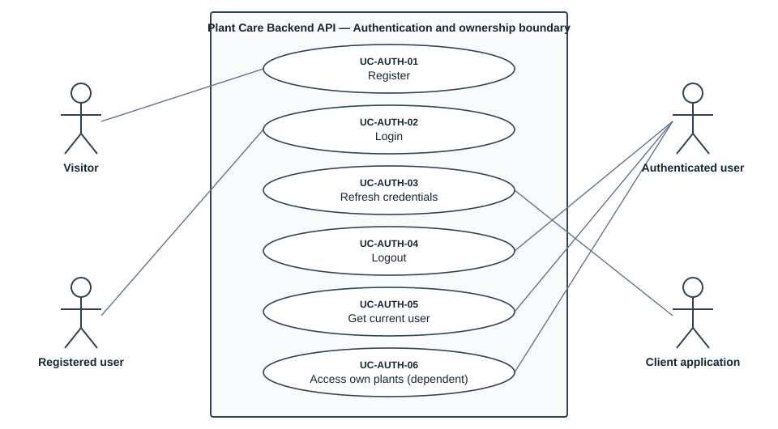

# Authentication — Use Cases (Levels 2 and 3)

**Status:** Accepted MVP policy; implementation and verification in progress.  
**Parent:** [UC-SYS-01 — System Overview](../../02-requirements/use-case-overview.md).  
**Policy:** [FSD §8](fsd.md#8-mvp-api-and-security-policy-proposed-for-approval) · [Design](design.md) · [Test Cases](test-cases.md). The approved idle timeout is 24 hours. The FSD owns shared policy; this document owns detailed flows.

## Level 2 — Feature decomposition

| ID | Use Case | Parent | Scope |
|---|---|---|---|
| UC-AUTH-01 | [Register](#uc-auth-01--register) | UC-SYS-01 | MVP |
| UC-AUTH-02 | [Login](#uc-auth-02--login) | UC-SYS-01 | MVP |
| UC-AUTH-03 | [Refresh credentials](#uc-auth-03--refresh-credentials) | UC-SYS-01 | MVP |
| UC-AUTH-04 | [Logout](#uc-auth-04--logout) | UC-SYS-01 | MVP |
| UC-AUTH-05 | [Get current user](#uc-auth-05--get-current-user) | UC-SYS-01 | MVP |
| UC-AUTH-06 | [My Plants ownership boundary](#uc-auth-06--my-plants-ownership-boundary) | UC-SYS-04; depends on UC-SYS-01 | Dependent; not full My Plants scope |

## Level 3 — Detailed specifications

Shared policy: access JWT 15 minutes; refresh token 7 days; absolute Session lifetime 30 days; idle timeout 24 hours. Active Session requires no revocation and both expiry boundaries strictly in the future. Successful protected requests and successful refresh count as activity; updates are monotonic and cannot extend absolute expiry. Invalid requests do not extend idle lifetime. All errors use the FSD safe error envelope; never log secrets. Rate limiting is a production release gate, not a verified feature.

### UC-AUTH-01 — Register

| Field | Specification |
|---|---|
| Use Case ID | UC-AUTH-01 |
| Use Case Name | Register |
| Summary | Visitor creates an account without automatic login. |
| Actors | Visitor |
| Trigger | `POST /auth/register` |
| Pre-conditions | No authenticated session required. |
| Post-conditions (success) | User created; no Session or RefreshToken. |
| Post-conditions (failure) | No new User on rejection or failed persistence. |

**Basic Path**

1. Visitor submits email and password.
2. System validates and normalizes email.
3. System hashes password with Argon2id.
4. System persists User with unique normalized email.
5. System returns 201 with id/email.

**Alternative Paths**

- A1: None specified for MVP.

**Exception Paths**

- E1: At step 2: malformed input or password outside 12–128 characters → 400.
- E2: At step 4: duplicate normalized email → 409; no duplicate User.
- E3: At steps 3–4: unexpected failure → 500; no partial User.

**Business Rules:** FSD §8.3; FR-AUTH-01, 11.

**Non-functional Requirements:** Secure hashing; no plaintext password in persistence or logs; safe errors. No unapproved numerical performance targets are asserted.

**Traceability:** [FSD](fsd.md) · [Design](design.md) · [Test Cases](test-cases.md): TC-AUTH-01, 11, 21, 24.

### UC-AUTH-02 — Login

| Field | Specification |
|---|---|
| Use Case ID | UC-AUTH-02 |
| Use Case Name | Login |
| Summary | Registered user obtains credentials for a new independent Session. |
| Actors | Registered user |
| Trigger | `POST /auth/login` |
| Pre-conditions | No active Session required; valid account and password are success conditions. |
| Post-conditions (success) | One new Session and initial unconsumed RefreshToken; credentials returned. |
| Post-conditions (failure) | No partial Session/token on failure. |

**Basic Path**

1. Client submits credentials.
2. System validates input and normalizes email.
3. System verifies credentials without revealing account existence.
4. System prepares JWT and opaque refresh secret; persists Session and initial verifier atomically; initializes lastActivityAt.
5. System returns 200 credential envelope after commit.

**Alternative Paths**

- A1: Existing active Sessions remain independent; new login creates another Session.

**Exception Paths**

- E1: At step 2: malformed input → 400.
- E2: At step 3: unknown account or incorrect password → generic 401.
- E3: At step 4: unexpected failure → 500; rollback persistence.

**Business Rules:** FSD §8.1–8.4; FR-AUTH-02, 03, 11.

**Non-functional Requirements:** No account enumeration; secure verifier and signing keys; atomic persistence; rate limiting release gate. No unapproved numerical performance targets are asserted.

**Traceability:** [FSD](fsd.md) · [Design](design.md) · [Test Cases](test-cases.md): TC-AUTH-02, 03, 11, 18, 19, 24.

### UC-AUTH-03 — Refresh credentials

| Field | Specification |
|---|---|
| Use Case ID | UC-AUTH-03 |
| Use Case Name | Refresh credentials |
| Summary | Rotate refresh token within its original Session. |
| Actors | Client application holding refresh secret |
| Trigger | `POST /auth/refresh` |
| Pre-conditions | A refresh request can be submitted even if access JWT expired; active Session and valid unconsumed token are success conditions. |
| Post-conditions (success) | Predecessor consumed; exactly one successor in same Session; activity updated; new credentials returned. |
| Post-conditions (failure) | No partial rotation; replay revocation persists when required. |

**Basic Path**

1. Client submits opaque refresh token in JSON.
2. System validates input and derives verifier.
3. System locates token, begins transaction, locks Session and re-reads state.
4. System verifies token and Session eligibility.
5. System conditionally consumes predecessor, inserts successor linked to parent, updates activity monotonically.
6. System commits and returns 200 new credentials.

**Alternative Paths**

- A1: At step 4: consumed-token replay on active Session → revoke affected Session, commit, return 401; no successor.
- A2: Concurrent duplicate refresh: at most one consumes predecessor; strict replay may revoke Session.

**Exception Paths**

- E1: At step 2: malformed input → 400.
- E2: At steps 3–4: unknown, expired or otherwise revoked token, or inactive Session → 401; no successor.
- E3: At step 5: insertion or transaction failure → rollback and 500; predecessor not left consumed.

**Business Rules:** BR-AUTH-01–08; FR-AUTH-04–07, 09–11; FSD §8.2, §8.5.

**Non-functional Requirements:** Atomicity, Session serialization, one successor, Composite FK same-Session defense. Prisma Client join behavior NOT VERIFIED; real PostgreSQL integration test required. No unapproved numerical performance targets are asserted.

**Traceability:** [FSD](fsd.md) · [Design](design.md) · [Test Cases](test-cases.md): TC-AUTH-04–07, 09–11, 17, 19, 25–27.

### UC-AUTH-04 — Logout

| Field | Specification |
|---|---|
| Use Case ID | UC-AUTH-04 |
| Use Case Name | Logout |
| Summary | End the current Session without affecting other devices. |
| Actors | Authenticated user via client |
| Trigger | `POST /auth/logout` |
| Pre-conditions | Bearer JWT and active Session required for 204; repeated requests may reach endpoint with revoked Session. |
| Post-conditions (success) | Current Session revoked with LOGOUT; subsequent protected requests and refresh denied. |
| Post-conditions (failure) | No unrelated Session revoked; unexpected failure does not claim success. |

**Basic Path**

1. Client submits bearer JWT.
2. System validates JWT and identifies Session.
3. System locks Session and rechecks active status.
4. System revokes Session with LOGOUT and commits.
5. System returns 204; client clears local authentication state.

**Alternative Paths**

- A1: At steps 2–3: repeated logout with same JWT and revoked Session → 401, expected behavior; client clears access/refresh/user/session state, treats logout complete, no error notification.

**Exception Paths**

- E1: At steps 2–3: other invalid JWT or inactive Session → 401.
- E2: At step 4: unexpected persistence failure → 500; no claimed revocation.

**Business Rules:** FSD §8.2–8.4; FR-AUTH-08; BR-AUTH-02.

**Non-functional Requirements:** Session revocation enforced on subsequent requests; serialize lifecycle writes; no secrets in logs. No unapproved numerical performance targets are asserted.

**Traceability:** [FSD](fsd.md) · [Design](design.md) · [Test Cases](test-cases.md): TC-AUTH-08, 16, 23.

### UC-AUTH-05 — Get current user

| Field | Specification |
|---|---|
| Use Case ID | UC-AUTH-05 |
| Use Case Name | Get current user |
| Summary | Return the authenticated user’s own identity. |
| Actors | Authenticated user |
| Trigger | `GET /auth/me` |
| Pre-conditions | Bearer credential supplied; active Session required for success. |
| Post-conditions (success) | 200 id/email only; successful activity recorded. |
| Post-conditions (failure) | No user data disclosed on failure; no activity extension on rejection. |

**Basic Path**

1. Client sends bearer JWT.
2. System verifies signature, issuer, audience, expiry and sub/sid binding.
3. System validates active Session and reads User by verified sub.
4. System records successful activity and returns 200 id/email.

**Alternative Paths**

- A1: None specified for MVP.

**Exception Paths**

- E1: At steps 2–3: invalid JWT, missing User or missing/revoked/expired Session → 401.
- E2: Unexpected persistence failure → 500 with safe error.

**Business Rules:** FSD §8.1–8.4; BR-02.

**Non-functional Requirements:** No password hash disclosed; enforce absolute and idle expiry; monotonic activity. No unapproved numerical performance targets are asserted.

**Traceability:** [FSD](fsd.md) · [Design](design.md) · [Test Cases](test-cases.md): TC-AUTH-16, 19, 22, 25.

### UC-AUTH-06 — My Plants ownership boundary

| Field | Specification |
|---|---|
| Use Case ID | UC-AUTH-06 |
| Use Case Name | My Plants ownership boundary |
| Summary | Prevent cross-account access to saved plants; dependent feature only. |
| Actors | Authenticated user |
| Trigger | `Protected My Plants operation (endpoint TBD in feature contract)` |
| Pre-conditions | Valid JWT and active Session for success; My Plants feature required. |
| Post-conditions (success) | Only own plants read or mutated; successful activity recorded. |
| Post-conditions (failure) | No cross-account data disclosed or modified. |

**Basic Path**

1. Client requests plant operation.
2. System validates JWT and Session.
3. System derives owner identity from verified sub, never client ownerId.
4. System scopes read/write to verified owner.
5. System returns feature-defined result and records successful activity.

**Alternative Paths**

- A1: None specified; full My Plants flows belong to its future feature specification.

**Exception Paths**

- E1: At step 2: invalid credentials or inactive Session → 401.
- E2: At step 4: another user’s plant → no disclosure or mutation; 404 recommended, final feature contract pending.
- E3: Unexpected persistence failure → safe 500.

**Business Rules:** FR-AUTH-12; BR-02; FSD §8.3.

**Non-functional Requirements:** Ownership isolation; no cross-user data exposure; session validation. No unapproved numerical performance targets are asserted.

**Traceability:** [FSD](fsd.md) · [Design](design.md) · [Test Cases](test-cases.md): TC-AUTH-12 (blocked until My Plants exists).

## Maintenance

Review Level 1 first, then Level 2 and Level 3; update affected FSD, design and tests together. PlantUML source requires an external renderer. No tests are claimed executed by this document.
