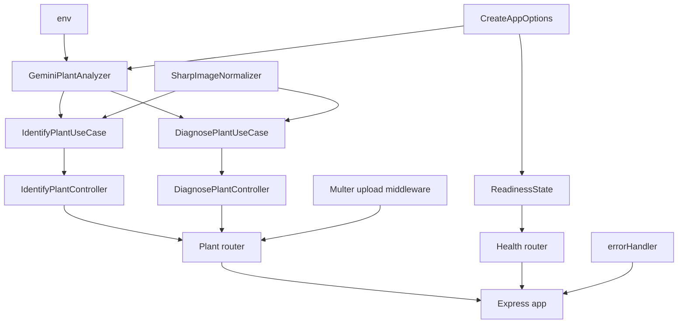

# Dependency injection và composition trong `createApp()`

`src/app.ts` là composition root của ứng dụng: nó tạo các implementation cụ thể, ghép chúng vào use case và controller, rồi đăng ký router/middleware với Express. Đây là dependency injection bằng constructor và object options, không dùng DI container.

## Composition thực tế

- `GeminiPlantAnalyzer` là mặc định, nhận `GEMINI_API_KEY`, `GEMINI_MODEL` và `GEMINI_TIMEOUT_MS` từ `env`.
- `CreateAppOptions.plantAnalyzer` cho phép caller cung cấp một implementation `PlantAnalyzer` khác. Đây là seam dùng được cho test hoặc provider thay thế.
- `SharpImageNormalizer` hiện luôn được khởi tạo trong `createApp()`; interface `ImageNormalizer` được truyền vào hai use case qua constructor.
- `CreateAppOptions.readinessState` có thể được truyền từ `server.ts`, nơi lifecycle server gọi `markReady()` sau khi `listen()` và `markNotReady()` khi graceful shutdown bắt đầu.
- `createImageUploadMiddleware(env.MAX_IMAGE_MB)` tạo Multer instance và được inject vào `createPlantRouter()`.

## Ranh giới dependency

Application layer chỉ biết `PlantAnalyzer` và `ImageNormalizer` ở domain. Vì vậy `IdentifyPlantUseCase` và `DiagnosePlantUseCase` không import Google SDK, Sharp hay Express. HTTP layer biết controller và Multer; infrastructure layer giữ chi tiết Gemini, Sharp và readiness.

Thiết kế này giảm coupling cho các dependency đã được abstract. Nó không có nghĩa mọi dependency đều đã được thay thế dễ dàng: normalizer vẫn được chọn trực tiếp trong `createApp()`, và cấu hình môi trường được import tại composition root.

## Thứ tự đăng ký middleware

Health router và plant router được gắn trước `errorHandler`. Vị trí cuối của error handler là cần thiết để lỗi được controller hoặc middleware chuyển tiếp có nơi xử lý tập trung.
