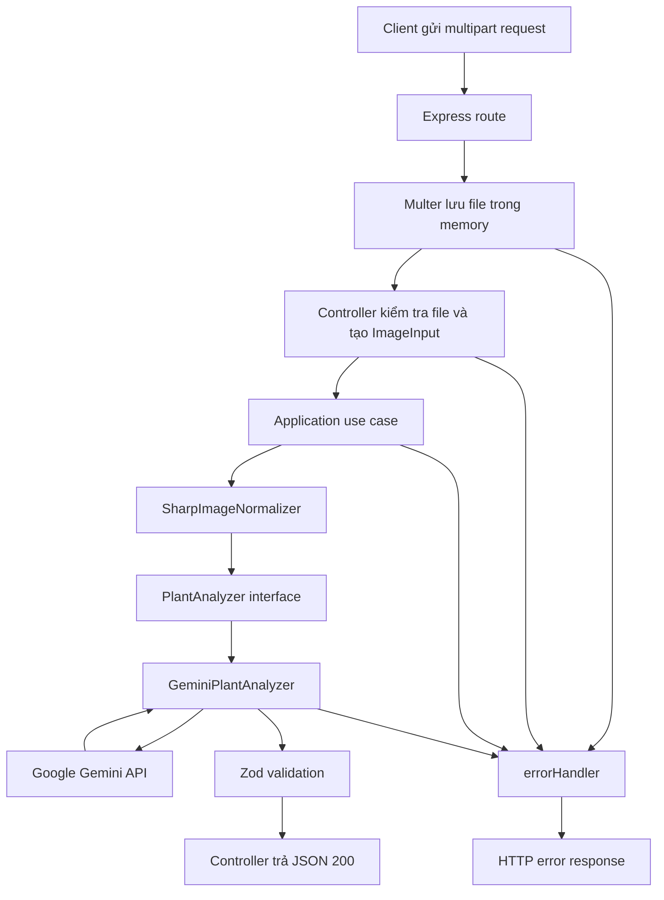
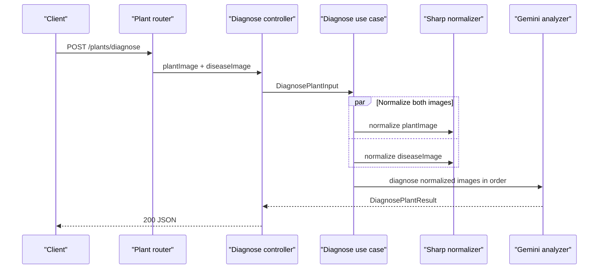

# Vòng đời HTTP request

Tài liệu này mô tả đường đi thực tế của request trong source code hiện tại. Hai endpoint nghiệp vụ là `POST /plants/identify` và `POST /plants/diagnose`; `GET /health` đi theo router health riêng.

## Luồng chung

`upload-file.middleware.ts` dùng `multer.memoryStorage()`, vì vậy bytes của file nằm trong memory của process trong suốt request. Giới hạn mỗi file được cấu hình từ `MAX_IMAGE_MB`.

## Identify

1. `createPlantRouter()` gắn `upload.single('image')` cho `/identify`.
2. `IdentifyPlantController` trả `400` nếu không có `req.file`, hoặc chuyển buffer và MIME type thành một `ImageInput`.
3. `IdentifyPlantUseCase` yêu cầu đúng một ảnh; nếu khác, nó ném `ImageInputError`.
4. Use case chuẩn hóa ảnh rồi gọi `PlantAnalyzer.identify()`.
5. Adapter Gemini gọi provider, parse JSON và kiểm tra response trước khi controller trả `200`.

## Diagnose

`upload.fields()` nhận một `plantImage` và một `diseaseImage`. Controller từ chối request thiếu một trong hai file với `400`. `DiagnosePlantUseCase` chuẩn hóa hai ảnh song song bằng `Promise.all`, sau đó giữ thứ tự `[plantImage, diseaseImage]` khi gọi analyzer. Thứ tự này có ý nghĩa với instruction của Gemini.

## Đường đi của lỗi

Lỗi được chuyển về middleware cuối cùng qua `next(error)`. Middleware hiện ánh xạ `MulterError` và `ImageInputError` thành `400` hoặc `413`; `PlantAnalyzerError` được ánh xạ thành `429`, `504`, `503` hoặc `500` tùy `code`. Một lỗi không thuộc các nhóm đó trả `500` với mã `INTERNAL_ERROR`.

Không có validation MIME type tại Multer. MIME type được chuyển cho Sharp và Gemini; `SharpImageNormalizer` chỉ chấp nhận ảnh có metadata JPEG hoặc PNG.
