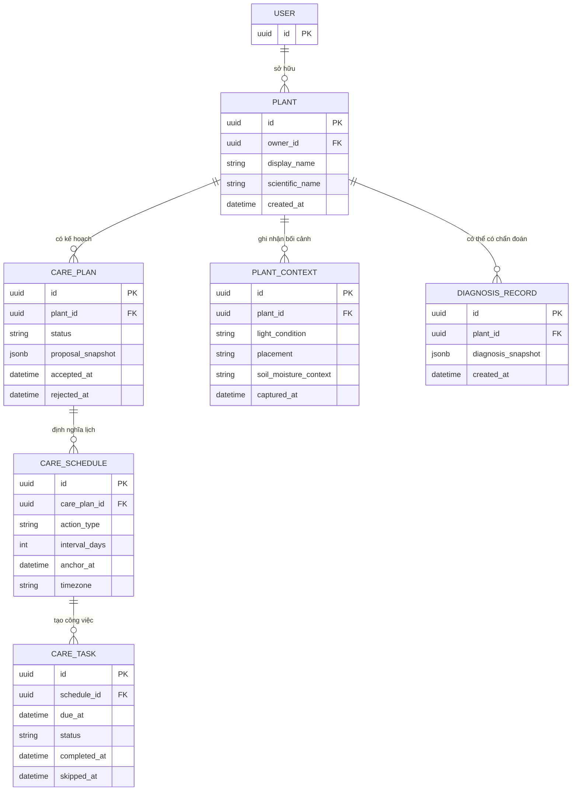
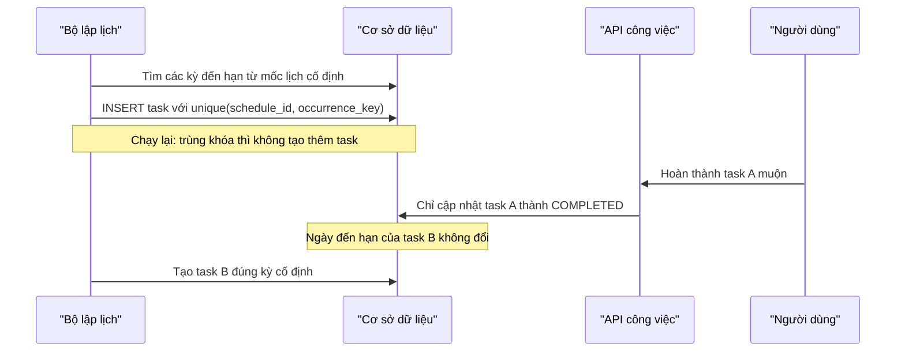
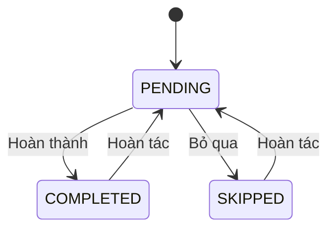

# Plant Care — Thiết kế mô hình dữ liệu (Đề xuất MVP)

> **Trạng thái:** Đề xuất thiết kế kỹ thuật — **chưa triển khai**.  
> **Cơ sở:** `docs/02-business-analysis/features/care-planning.md`, `docs/02-business-analysis/requirements/business-rules.md`, `docs/06-decisions/product/README.md` trên nhánh `main` (đối chiếu ngày 22/11/2026).  
> **Phạm vi:** Nhận diện cây → Lưu cây → Xem kế hoạch AI đề xuất → Chấp nhận/Từ chối → Lịch chăm sóc cố định → Danh sách công việc và lịch sử.  
> **Ngoài phạm vi:** Triển khai xác thực, thông báo đẩy, tạo lại kế hoạch, AI tự động thay đổi kế hoạch, migration cơ sở dữ liệu.

## 1. Mục tiêu thiết kế và ranh giới

`IdentifyPlantResult.carePlan` hiện tại chỉ chứa **gợi ý chăm sóc dạng mô tả**, không phải `CarePlan` đã được người dùng chấp nhận hoặc lập lịch. Lưu kết quả nhận diện không được tự động kích hoạt công việc chăm sóc. Lịch sử chẩn đoán là phần tùy chọn trong giai đoạn triển khai chức năng xuyên suốt đầu tiên (*vertical slice*).

**Các nguyên tắc bất biến:**

- Kế hoạch AI đề xuất chỉ được kích hoạt sau khi người dùng chấp nhận (BRU-03/04).
- Từ chối kế hoạch không tạo lịch chăm sóc đang hoạt động.
- Mỗi kỳ lặp tạo một công việc độc lập, kể cả khi công việc kỳ trước còn chờ hoặc quá hạn (BRU-08).
- Hoàn thành hoặc bỏ qua công việc không làm dịch chuyển mốc lịch cố định (BRU-11).
- Quá hạn (*Overdue*) là trạng thái hiển thị suy ra từ công việc đang chờ và thời điểm đến hạn; không lưu thành một trạng thái kết thúc riêng.
- Thông tin môi trường chưa được cung cấp phải giữ là **chưa biết**, không tự suy đoán (BRU-02).
- MVP không cho phép chỉnh sửa/tạo lại kế hoạch (PD-012) và không tự động thay thế kế hoạch đã duyệt.

## 2. Sơ đồ quan hệ thực thể (ERD) ở mức khái niệm



**Lưu ý:** `USER` và `DIAGNOSIS_RECORD` là các ranh giới dự kiến trong tương lai; việc xuất hiện trong ERD **không có nghĩa** xác thực hoặc lưu lịch sử đã được triển khai. Thuộc tính `PLANT_CONTEXT` chỉ là ví dụ; 2–3 câu hỏi cá nhân hóa chính xác chưa được phê duyệt. MVP chưa cần bảng `CARE_HISTORY` riêng nếu “lịch sử” chỉ là trạng thái hiện tại và mốc thời gian của công việc, không phải nhật ký kiểm toán đầy đủ.

## 3. Các thực thể và trường dữ liệu đề xuất

| Thực thể | Trường dữ liệu tối thiểu dự kiến | Mục đích / ràng buộc |
|---|---|---|
| `Plant` | `id`, `ownerId` (chờ quyết định xác thực), `displayName`, `scientificName?`, `identificationSnapshot?`, `createdAt`, `updatedAt` | Một cây cụ thể của người dùng, không phải danh mục loài cây |
| `PlantContext` | `id`, `plantId`, các trường bối cảnh có thể `NULL`, `capturedAt` | Chỉ lưu dữ kiện người dùng thực sự cung cấp; thiếu dữ liệu nghĩa là chưa biết |
| `CarePlan` | `id`, `plantId`, `status`, `proposalSnapshot`, `createdAt`, `acceptedAt?`, `rejectedAt?` | Bản đề xuất AI không tự sửa sau khi tạo; trạng thái `PROPOSED`, `ACCEPTED`, `REJECTED` |
| `CareSchedule` | `id`, `carePlanId`, `actionType`, `instruction`, `intervalDays`, `anchorAt`, `timezone`, `createdAt` | Quy tắc lặp cố định; chỉ lịch thuộc kế hoạch được chấp nhận mới hoạt động |
| `CareTask` | `id`, `scheduleId`, `occurrenceKey`, `dueAt`, `status`, `completedAt?`, `skippedAt?`, `createdAt`, `updatedAt` | Một kỳ công việc độc lập; trạng thái `PENDING`, `COMPLETED`, `SKIPPED` |
| `DiagnosisRecord` | `id`, `plantId`, `diagnosisSnapshot`, `createdAt` | Giai đoạn tùy chọn về sau; chưa đưa vào migration đầu tiên nếu chưa có yêu cầu |

**Lưu ý về định danh:** `User`/`ownerId` hiện là thành phần giữ chỗ trong mô hình. Chưa quyết định dùng tài khoản hay sở hữu ẩn danh, cũng như chính sách xóa dữ liệu (OQ-CP-05). Không nên tạo schema production dựa trên một phương án xác thực chưa được chốt.

## 4. Ràng buộc cần bảo đảm khi lưu trữ

1. `CareSchedule.intervalDays > 0`: không cho phép chu kỳ bằng 0 hoặc âm.
2. `CareTask.status` chỉ nhận `PENDING`, `COMPLETED`, `SKIPPED`.
3. Với `PENDING`, cả `completedAt` và `skippedAt` phải là `NULL`; với `COMPLETED`, chỉ có `completedAt`; với `SKIPPED`, chỉ có `skippedAt`.
4. `UNIQUE (schedule_id, occurrence_key)` ngăn tạo trùng công việc khi scheduler chạy lại hoặc khởi động lại.
5. Chỉ kế hoạch `ACCEPTED` mới được tạo lịch/công việc đang hoạt động; kiểm tra trong transaction ở tầng ứng dụng vì điều kiện liên bảng không thể biểu diễn bằng một SQL `CHECK` đơn giản.
6. Mỗi cây có **tối đa một kế hoạch được chấp nhận và đang hoạt động** (đây là đề xuất kỹ thuật, chưa phải quyết định nghiệp vụ đã xác nhận). Nếu `ACCEPTED` đồng nghĩa với đang hoạt động, PostgreSQL có thể dùng partial unique index theo `plant_id` với `status = 'ACCEPTED'`. Nếu cần giữ nhiều kế hoạch đã chấp nhận trong lịch sử, phải tách `status` khỏi `is_active` và xác định chính sách thay thế.
7. Chỉ chủ sở hữu được cấp quyền mới có thể sửa công việc thuộc cây của mình. Phải kiểm tra quyền trong truy vấn/tầng ứng dụng, không tin `plantId` do client gửi.
8. Lưu thời điểm dưới dạng UTC (`timestamptz`), đồng thời lưu múi giờ IANA như `Asia/Ho_Chi_Minh` trên lịch. Không coi một ngày lịch địa phương luôn bằng 24 giờ ở mọi múi giờ.

## 5. Lặp lịch và chống tạo trùng (Idempotency)

Một lịch đề xuất sử dụng `anchorAt`, `intervalDays` và `timezone`. Thuật toán chính xác cho lịch theo ngày địa phương và giờ mùa hè (DST) vẫn cần quyết định. **Không tính kỳ tiếp theo bằng `lastCompletedAt + intervalDays`**, vì sẽ vi phạm PD-010.



`occurrenceKey` có thể là ngày/giờ lịch địa phương được chuẩn hóa hoặc chỉ số kỳ tăng dần tính từ mốc cố định. Phải **chọn một định nghĩa** trước khi viết migration. Chỉ tạo các kỳ trong khoảng thời gian hữu hạn, có quy tắc tạo bù kỳ bị bỏ lỡ và thao tác upsert an toàn khi chạy đồng thời; không tạo vô hạn công việc quá khứ khi mới kích hoạt lịch.

## 6. Vòng đời công việc chăm sóc



Trạng thái hiển thị được suy ra:

```ts
const displayStatus = task.status === 'PENDING' && now > task.dueAt
  ? 'OVERDUE'
  : task.status;
```

`COMPLETED` chỉ là xác nhận của người dùng, không phải bằng chứng đã tưới cây ngoài thực tế. Khi hoàn tác, cần xóa timestamp của trạng thái kết thúc trước đó. Với hai thao tác đồng thời, sử dụng transaction và kiểm tra trạng thái/phiên bản kỳ vọng; không để lần cập nhật sau âm thầm ghi đè lần trước.

## 7. Ranh giới transaction

- **Chấp nhận kế hoạch:** khóa/kiểm tra kế hoạch đang `PROPOSED`, đổi thành `ACCEPTED`, lưu các lịch (và các kỳ đầu nếu cần) trong **một transaction**. Nếu thất bại, không trả thông báo kích hoạt thành công.
- **Từ chối kế hoạch:** chuyển `PROPOSED → REJECTED`, không tạo lịch. MVP chưa định nghĩa thao tác từ chối sau khi đã chấp nhận; nên trả lỗi xung đột thay vì tự tắt lịch.
- **Hoàn thành/Bỏ qua/Hoàn tác:** chỉ cập nhật đúng task được chọn, kiểm tra quyền sở hữu và trạng thái trước đó, cập nhật timestamp một cách nguyên tử.
- **Bộ lập lịch:** chèn mỗi kỳ bằng khóa duy nhất để chống trùng, chẳng hạn `INSERT ... ON CONFLICT DO NOTHING` hoặc cách tương đương trong ORM.

## 8. Các chỉ mục (index) đề xuất

| Chỉ mục | Mục đích |
|---|---|
| `Plant(ownerId, createdAt DESC)` | Truy vấn danh sách cây của người dùng |
| `CarePlan(plantId, createdAt DESC)` | Xem đề xuất và lịch sử kế hoạch |
| `CareSchedule(carePlanId)` | Tải lịch của một kế hoạch |
| `CareTask(scheduleId, occurrenceKey)` — UNIQUE | Chống tạo trùng |
| `CareTask(scheduleId, dueAt)` | Xem công việc theo thời gian |
| `CareTask(status, dueAt)` | Truy vấn công việc đang chờ/đến hạn; chỉ thêm khi phù hợp quy mô và mẫu truy vấn |

Đây là **ứng viên index**, chưa phải tối ưu đã được chứng minh bằng benchmark. Cần đánh giá lại sau khi biết truy vấn và khối lượng dữ liệu thực tế.

## 9. Các quyết định chưa chốt — bắt buộc làm rõ trước migration

| ID | Câu hỏi | Đề xuất / ảnh hưởng |
|---|---|---|
| DB-01 | Dùng xác thực tài khoản hay người dùng ẩn danh? | Phải chốt quyền sở hữu trước khi thiết kế schema và phân quyền |
| DB-02 | Điều gì xảy ra sau khi Reject? | BA xác định không có kế hoạch hoạt động; cần chốt điều hướng UX, không tự thêm regenerate |
| DB-03 | Nếu cập nhật bối cảnh sau khi Accept thì sao? | Lưu dữ kiện mới, không âm thầm sửa kế hoạch; cần thông báo rõ cho người dùng |
| DB-04 | Múi giờ, giờ đến hạn địa phương, DST và mốc lịch là gì? | Chốt ngữ nghĩa tính kỳ lặp |
| DB-05 | Tạo task đúng lúc hay tạo trước? | Đề xuất tạo trước trong khoảng hữu hạn và tạo bù chống trùng; cần phê duyệt |
| DB-06 | Có được giữ nhiều kế hoạch đã chấp nhận trong lịch sử? | Phân biệt “đã duyệt” và “đang hoạt động” trước khi tạo partial unique index |
| DB-07 | Xóa cây: xóa dây chuyền, xóa mềm hay giữ dữ liệu bao lâu? | Ảnh hưởng quyền riêng tư và kiểm toán |
| DB-08 | Schema đầu ra AI Care Plan có cấu trúc gì? | Cần loại công việc, chu kỳ, điều kiện có thể validate; `carePlan` của Identify hiện chưa đủ |

## 10. Thứ tự triển khai đề xuất

1. Chốt DB-01, DB-04, DB-06, DB-08 và ghi lại quyết định.
2. Thêm lưu trữ `Plant` tối thiểu và ranh giới Repository; kiểm chứng tạo/lấy cây đúng quyền sở hữu.
3. Thêm `CarePlan` có cấu trúc và transaction Accept/Reject.
4. Thêm `CareSchedule`, `CareTask`, khóa chống trùng và test bộ lập lịch.
5. Thêm Complete/Skip/Undo và cách hiển thị Overdue; kiểm thử cập nhật đồng thời và timestamp.
6. Thêm lịch sử Diagnose nếu giai đoạn lõi đã hoạt động và có yêu cầu.

## 11. Liên kết truy vết yêu cầu

- [Đặc tả Care Planning](../../02-business-analysis/features/care-planning.md)
- [Quy tắc nghiệp vụ](../../02-business-analysis/requirements/business-rules.md)
- [Các quyết định sản phẩm](../../06-decisions/product/README.md)
- [Kiến trúc hiện tại](../architecture/system-overview.md)
- [API hiện tại](../../04-api/api-overview.md)

**Điều kiện duyệt thiết kế:** Đây là đề xuất. Chưa khẳng định đã có Prisma model, migration, scheduler, endpoint mới hoặc automated test tương ứng.
