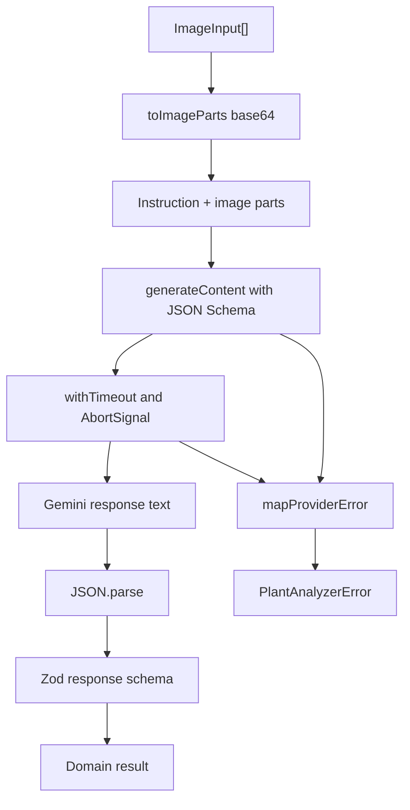

# Tích hợp Gemini và xử lý response

`GeminiPlantAnalyzer` là adapter thực thi `PlantAnalyzer`. Adapter chịu trách nhiệm chuyển domain input sang Google GenAI SDK, áp dụng timeout, xác thực response và đổi lỗi provider thành `PlantAnalyzerError`.

## Request đến provider

Mỗi `ImageInput` được đổi sang `Part.inlineData`, với bytes được Base64 encode và MIME type đi kèm. `identify()` gửi instruction nhận diện cùng một hoặc nhiều image parts mà use case cung cấp; use case hiện chỉ cho phép đúng một ảnh.

`diagnose()` nhận hai ảnh theo thứ tự use case đã đưa vào. Instruction ghi rõ ảnh đầu dùng cho nhận diện cây và ảnh thứ hai cho vùng nghi bệnh, đồng thời yêu cầu một phân tích chung trong một Gemini request. Code không tự xác minh số lượng ảnh bên trong adapter; trách nhiệm số lượng/đầu vào nằm ở controller và use case.

## Hai lớp validation response

Google SDK nhận `responseMimeType: 'application/json'` và JSON Schema (`identifyGeminiSchema` hoặc `diagnoseGeminiSchema`) trong request. Đây là ràng buộc output được gửi đến provider. Khi nhận response, adapter vẫn `JSON.parse()` rồi dùng Zod (`identifyResponseSchema` hoặc `diagnoseResponseSchema`) để kiểm tra runtime trước khi trả domain result. Response trống, JSON không hợp lệ hoặc không khớp Zod đều trở thành `PlantAnalyzerError` với mã `INVALID_RESPONSE`.

## Timeout và lỗi provider

Lời gọi `generateContent()` được bao bằng `withTimeout()`, nhận `AbortSignal` qua `config.abortSignal`. `TimeoutError` thành `TIMEOUT`; `ApiError` HTTP 429 thành `RATE_LIMITED`; `ApiError` từ 500 trở lên thành `UNAVAILABLE`; các trường hợp khác thành `UNKNOWN`. Error handler HTTP thực hiện ánh xạ status ở lớp ngoài.

Hiện không có retry, backoff hay jitter quanh lời gọi Gemini. Các biến môi trường `GEMINI_MAX_RETRIES` và `GEMINI_RETRY_BASE_DELAY_MS` được schema cấu hình chấp nhận, nhưng source hiện không dùng chúng để thay đổi request.
