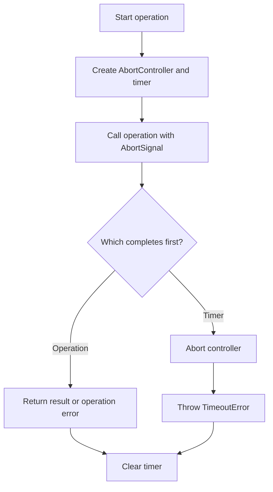

# Timeout và cancellation

## 1. Problem and motivation

Gemini là dependency mạng. Nếu request không có deadline, HTTP request có thể chờ rất lâu và giữ tài nguyên process.

## 2. Design thinking

Backend đặt một giới hạn thời gian cho operation. Khi provider trả kết quả sớm, kết quả được dùng. Khi thời gian hết trước, backend báo timeout và gửi tín hiệu hủy cho SDK.

## 3. Algorithm

`withTimeout()` tạo `AbortController` và một timer. Nó chạy operation với `controller.signal`, đồng thời tạo promise timeout. `Promise.race()` lấy kết quả đến trước. Nếu timer thắng, controller bị abort rồi `TimeoutError` được reject. Dù kết quả nào thắng, `finally` gọi `clearTimeout()` để không còn timer treo.

## 4. Mermaid workflow

## 5. Important implementation concepts

- `Promise.race` không tự dừng promise thua cuộc; nó chỉ quyết định kết quả được await.
- `AbortController` tạo `AbortSignal` để operation có cơ hội dừng network work.
- Gemini adapter truyền signal vào `config.abortSignal` của SDK.
- Timer cleanup trong `finally` tránh timeout muộn sau khi operation đã xong.
- Cancellation có giới hạn: hiệu quả cuối cùng phụ thuộc SDK/provider có tôn trọng signal hay không.

## 6. Realistic example

Với `GEMINI_TIMEOUT_MS = 10000`, nếu Gemini trả response sau 2 giây, timer bị xóa và response tiếp tục qua validation. Nếu 10 giây trôi qua trước response, adapter nhận `TimeoutError`, đổi thành `PlantAnalyzerError('TIMEOUT')`, và HTTP middleware trả 504.

## 7. Edge cases

- Provider có thể hoàn tất gần cùng lúc timer chạy; race quyết định kết quả observable.
- Abort không đảm bảo provider đã dừng xử lý phía server.
- Timeout hiện bao quanh từng Gemini call; chưa có retry nên chưa có tổng budget qua nhiều attempt.

## 8. Trade-offs

Deadline ngắn giảm thời gian chờ nhưng có thể cắt request hợp lệ chậm. Deadline dài thân thiện hơn với provider chậm nhưng giữ tài nguyên lâu hơn.

## 9. Related source code

- `src/shared/async/with-timeout.ts`
- `src/shared/async/timeout.error.ts`
- `src/infra/gemini/gemini-plant-analyzer.ts`
- `src/http/middlewares/error-handler.middleware.ts`

## 10. Related ADR

[ADR-005 — Timeout và cancellation](../../06-decisions/architecture/ADR-005-timeout-and-cancellation.md)
