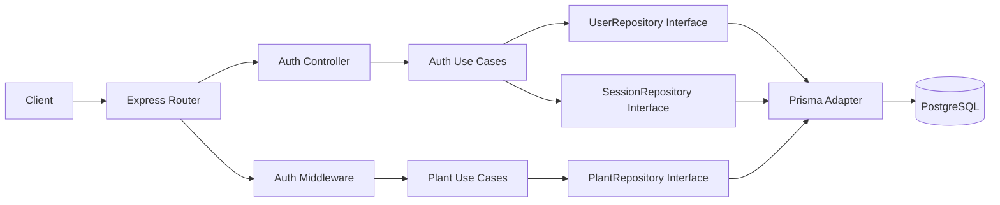
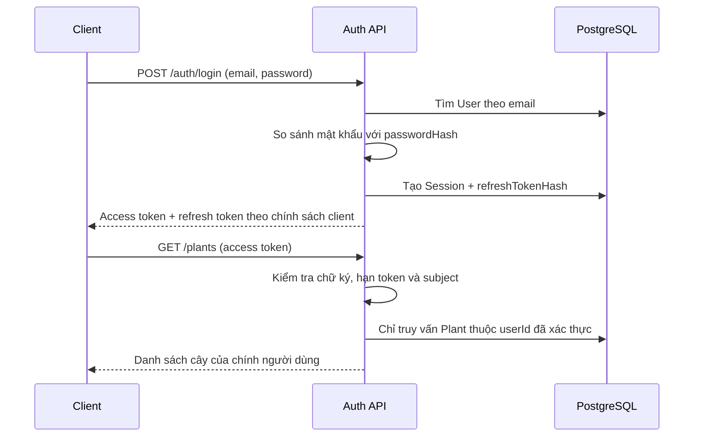

# Plant Care — Thiết kế xác thực và phân quyền (MVP)

> **Trạng thái:** Thiết kế đề xuất, chưa triển khai. **Quyết định đã thống nhất:** Người dùng phải đăng ký/đăng nhập để lưu cây trong My Plants. **Phương án kỹ thuật đã đồng ý về nguyên tắc:** JWT access token + refresh token; lưu hash của refresh token trong PostgreSQL và hỗ trợ thu hồi phiên.

## 1. Phạm vi

- Đăng ký bằng email/mật khẩu; đăng nhập; làm mới access token; đăng xuất một phiên; lấy thông tin người dùng hiện tại.
- `POST /plants/identify` và `/plants/diagnose` giữ nguyên trong giai đoạn đầu; quyết định bắt buộc đăng nhập với hai endpoint AI này chưa được xác nhận.
- Các endpoint lưu và xem cây (`My Plants`) yêu cầu xác thực và kiểm tra chủ sở hữu.
- Chưa bao gồm OAuth, quên mật khẩu, xác minh email, MFA, đăng xuất tất cả thiết bị hoặc phân quyền quản trị.

## 2. Kiến trúc

## 3. Quy trình đăng nhập

## 4. Chính sách bảo mật đề xuất

1. Mật khẩu lưu bằng thuật toán chuyên dụng như Argon2id; không lưu plaintext hoặc SHA-256 đơn thuần.
2. Access token ngắn hạn (đề xuất 15 phút), có `sub`, `iss`, `aud`, `exp`, `iat`, `jti`; xác thực thuật toán và khóa ký được cấu hình rõ ràng.
3. Refresh token là chuỗi ngẫu nhiên đủ mạnh; chỉ lưu hash ở database. Khi refresh, xoay vòng token và vô hiệu token cũ trong một transaction. Cần chính sách xử lý reuse/replay.
4. Web client: ưu tiên refresh token trong cookie `HttpOnly`, `Secure`, `SameSite` phù hợp; xác định CSRF protection trước khi triển khai. Mobile client cần cơ chế lưu trữ an toàn riêng. Không trả refresh token đồng thời qua JSON và cookie nếu chưa có chủ đích.
5. Tránh user enumeration khi login; giới hạn tốc độ đăng nhập và refresh; không ghi token, password hoặc dữ liệu nhạy cảm vào log.
6. `ownerId` luôn lấy từ `req.auth.userId`, không nhận từ body hoặc query. Với `GET /plants/:id`, truy vấn theo cả `id` và `ownerId`.
7. Logout thu hồi session; access token đã phát hành có thể còn hiệu lực đến khi hết hạn nếu không kiểm tra trạng thái session trên mỗi request. Phải chọn mức bảo đảm thu hồi phù hợp.
8. Khi tạo/refresh session cần xử lý cạnh tranh và giới hạn số phiên nếu sản phẩm yêu cầu.

## 5. API contract đề xuất

| Phương thức | Endpoint | Mục đích | Thành công |
|---|---|---|---|
| POST | `/auth/register` | Tạo tài khoản | `201` |
| POST | `/auth/login` | Đăng nhập, tạo phiên | `200` |
| POST | `/auth/refresh` | Xoay vòng refresh token | `200` |
| POST | `/auth/logout` | Thu hồi phiên | `204` |
| GET | `/auth/me` | Lấy user hiện tại | `200` |
| GET | `/plants` | Danh sách cây thuộc user | `200` |
| POST | `/plants` | Lưu cây | `201` |
| GET | `/plants/:id` | Xem cây thuộc user | `200` |

**Chưa chốt:** cấu trúc JSON, cookie policy, xác thực email, giới hạn mật khẩu và error envelope. Không coi bảng này là API đã tồn tại.

## 6. Acceptance criteria tối thiểu

- Đăng ký email trùng trả lỗi xác định, không tạo thêm user.
- Mật khẩu sai không tạo session.
- Access token thiếu/hết hạn/sai chữ ký bị từ chối.
- User A không thể đọc/sửa cây của User B, kể cả biết `plantId`.
- Refresh token đã xoay vòng không thể dùng lại; logout khiến refresh token bị vô hiệu.
- Không có mật khẩu hoặc token thô trong database/log.

## 7. Cần quyết định trước khi code

- **AUTH-01:** Client mục tiêu là web, mobile hay cả hai? Quyết định cách chuyển/lưu refresh token và CSRF.
- **AUTH-02:** Có bắt buộc xác minh email trước khi lưu cây không?
- **AUTH-03:** Chính sách logout và thu hồi access token ngay lập tức hay chờ TTL?
- **AUTH-04:** Có cho phép AI Identify/Diagnose không đăng nhập không?
- **AUTH-05:** Chọn thư viện hash, JWT, chính sách rate limit, quản lý khóa và secret.

## 8. Truy vết

- [Thiết kế mô hình dữ liệu](../database/data-model.md)
- [Business Requirements](../../../02-business-analysis/requirements/business-requirements.md)
- [Care Planning](../../../02-business-analysis/features/care-planning.md)
