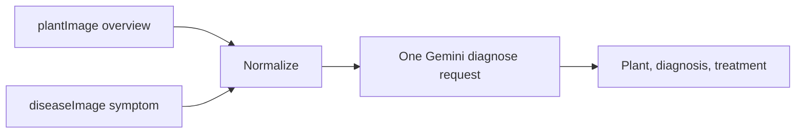

# ADR-003 — Chẩn đoán từ hai ảnh trong một Gemini request

- **Trạng thái:** Accepted

## Context

Diagnose cần vừa nhận diện cây vừa xem vùng có triệu chứng. Hai ảnh có ngữ cảnh liên quan: ảnh tổng quan và ảnh cận vùng nghi vấn.

## Decision

`POST /plants/diagnose` yêu cầu `plantImage` và `diseaseImage`. Hai ảnh được normalize song song và truyền theo đúng thứ tự vào một lần gọi `GeminiPlantAnalyzer.diagnose()`.

## Alternatives considered

- Hai request Gemini độc lập rồi ghép kết quả trong backend.
- Chỉ gửi ảnh có triệu chứng.
- Gửi ảnh tổng quan và bỏ ảnh triệu chứng.

## Rationale

Một request giữ được mối liên hệ giữa nhận diện cây và chẩn đoán. Instruction mô tả vai trò từng ảnh và yêu cầu Gemini phân tích cả hai cùng lúc.

## Consequences and trade-offs

- Payload và latency của một request có thể lớn hơn request một ảnh.
- Không có khả năng retry riêng phần nhận diện hoặc phần chẩn đoán, vì chúng là một provider operation.
- Thứ tự mảng ảnh là contract quan trọng giữa use case và instruction.

## Implementation references

- `src/http/routes/plant.route.ts`
- `src/http/controllers/diagnose-plant.controller.ts`
- `src/application/use-cases/diagnose-plant.use-case.ts`
- `src/infra/gemini/gemini-plant-analyzer.ts`

## Follow-up considerations

Đo chất lượng thực tế trước khi thay đổi prompt, thứ tự ảnh hoặc tách thành nhiều request. Không có benchmark hay đánh giá production được ghi nhận trong source.
