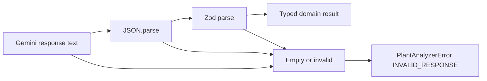

# ADR-004 — Validation response Gemini bằng JSON Schema và Zod

- **Trạng thái:** Accepted

## Context

Kết quả từ provider là dữ liệu bên ngoài. Dù request yêu cầu JSON, adapter không thể xem text response là domain result hợp lệ nếu chưa parse và kiểm tra.

## Decision

Gửi JSON Schema cho Gemini qua `responseSchema`, sau đó parse response text và kiểm tra runtime bằng Zod trước khi trả `IdentifyPlantResult` hoặc `DiagnosePlantResult`.

## Alternatives considered

- Tin cậy hoàn toàn vào structured-output configuration của provider.
- Chỉ `JSON.parse()` không kiểm tra shape.
- Để controller kiểm tra response.

## Rationale

JSON Schema hướng provider tạo output đúng dạng; Zod là guard độc lập ở runtime của backend. Adapter là nơi phù hợp để cô lập provider response khỏi application/domain.

## Consequences and trade-offs

- Có hai schema cần giữ đồng bộ: schema gửi provider và schema Zod.
- Response hợp lệ về JSON nhưng thiếu field hoặc enum sai sẽ bị từ chối thành `INVALID_RESPONSE`/HTTP 503.
- Error message hiện không phân biệt chi tiết parse JSON và lỗi Zod ở response công khai.

## Implementation references

- `src/infra/gemini/gemini-plant-analyzer.ts`
- `src/infra/gemini/schemas/identify-gemini.schema.ts`
- `src/infra/gemini/schemas/diagnose-gemini.schema.ts`
- `src/infra/gemini/schemas/identify-response.schema.ts`
- `src/infra/gemini/schemas/diagnose-response.schema.ts`

## Follow-up considerations

Khi thay đổi result contract, cập nhật đồng thời domain type, JSON Schema, Zod schema và test. Chỉ cân nhắc sinh schema từ một nguồn chung sau khi có nhu cầu rõ ràng.
