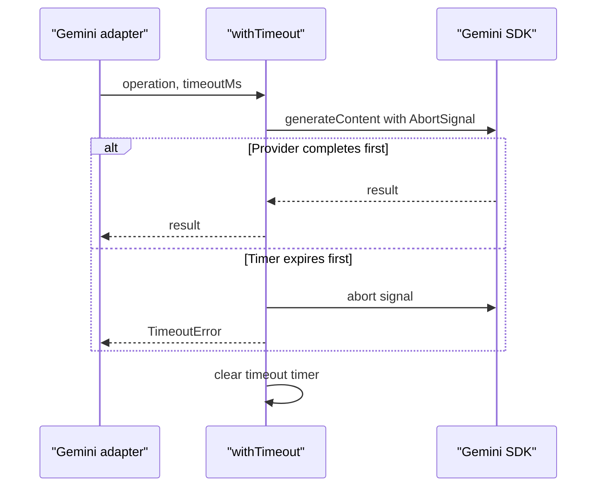

# ADR-005 — Timeout và cancellation cho Gemini request

- **Trạng thái:** Accepted

## Context

Gemini là dependency mạng ngoài tiến trình. Một request chờ không giới hạn sẽ giữ tài nguyên HTTP và làm trải nghiệm client khó dự đoán.

## Decision

Dùng `withTimeout()` với `Promise.race`, `AbortController` và `AbortSignal`. Khi timer hết hạn, controller bị abort và `TimeoutError` được reject; adapter đổi lỗi này thành `PlantAnalyzerError` mã `TIMEOUT`.

## Alternatives considered

- Không đặt timeout ở backend.
- Chỉ dùng `Promise.race` mà không gửi cancellation signal.
- Đặt timeout ở controller.

## Rationale

Utility dùng được cho operation bất đồng bộ và adapter có thể truyền signal cho Google SDK. `finally` dọn timer cho cả thành công, lỗi provider và timeout.

## Consequences and trade-offs

- `Promise.race` chỉ quyết định promise nào được trả về trước; cancellation hiệu quả phụ thuộc provider/SDK tôn trọng `AbortSignal`.
- Không có timeout budget chung cho nhiều attempt vì retry chưa được tích hợp.
- HTTP error handler ánh xạ `TIMEOUT` thành 504.

## Implementation references

- `src/shared/async/with-timeout.ts`
- `src/shared/async/timeout.error.ts`
- `src/infra/gemini/gemini-plant-analyzer.ts`
- `src/http/middlewares/error-handler.middleware.ts`

## Follow-up considerations

Xác định timeout theo dữ liệu latency thay vì suy đoán. Nếu thêm retry, phải quyết định timeout cho từng attempt và ngân sách tổng.
