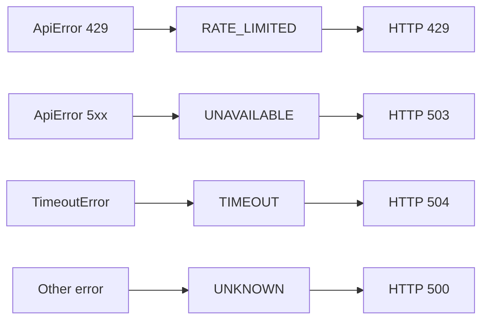

# ADR-006 — Ánh xạ lỗi provider vào lỗi domain và HTTP

- **Trạng thái:** Accepted

## Context

Google SDK trả lỗi phụ thuộc provider. HTTP layer cần contract ổn định để chọn status code mà không import `ApiError`.

## Decision

`GeminiPlantAnalyzer.mapProviderError()` đổi lỗi Gemini thành `PlantAnalyzerError`. `errorHandler` đổi error code domain thành HTTP response.

## Alternatives considered

- Trả nguyên `ApiError` ra middleware HTTP.
- Chỉ trả `500` cho mọi lỗi provider.
- Xử lý status code trực tiếp trong adapter.

## Rationale

Lỗi domain tách HTTP layer khỏi SDK và làm use case/provider adapter có contract rõ hơn. Middleware giữ trách nhiệm HTTP response tập trung.

## Consequences and trade-offs

- 4xx provider khác 429 hiện bị gom thành `UNKNOWN`/500.
- `INVALID_RESPONSE` được map thành 503 dù nó có thể là lỗi contract provider, không nhất thiết là unavailable.
- Adapter log chi tiết lỗi khi `NODE_ENV` không phải `production`; client chỉ nhận message đã kiểm soát.

## Implementation references

- `src/infra/gemini/gemini-plant-analyzer.ts`
- `src/domain/errors/plant-analyzer.error.ts`
- `src/domain/plant.types.ts`
- `src/http/middlewares/error-handler.middleware.ts`

## Follow-up considerations

Chỉ mở rộng taxonomy sau khi có error cases cần phân biệt. Khi thêm retry, định nghĩa retryability dựa trên error code/domain semantics, không dựa trực tiếp vào SDK type tại use case.
