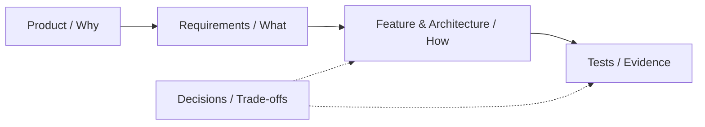

# Plant Care — Documentation Hub

> **Status:** Transitional index. Existing paths are preserved until each document has been reviewed and migrated. Links below refer to the current repository structure.

## How to read this repository

| Goal | Start here |
|---|---|
| Understand the product | [Vision](01-product/product-vision.md) → [BACCM](01-product/baccm-analysis.md) → [Roadmap](01-product/roadmap.md) |
| Understand requirements | [Business Requirements](02-business-analysis/requirements/business-requirements.md) → [Rules](02-business-analysis/requirements/business-rules.md) → [NFRs](02-business-analysis/requirements/non-functional-requirements.md) |
| Understand current backend | [System Overview](03-system-design/architecture/system-overview.md) → [Request Flow](03-system-design/architecture/request-flow.md) → [Current API](04-api/api-overview.md) |
| Understand database direction | [Data Model](03-system-design/database/data-model.md) → [Prisma Schema Design](03-system-design/database/prisma-schema-design.md) |
| Understand testing | [Identify Test Workflow](05-testing/test-scenarios.md) → [Diagnose Test Workflow](05-testing/diagnose-usecase-workflow.md) |
| Understand decisions | [ADR Index](06-decisions/README.md) → [Product Decisions](06-decisions/product/README.md) |

## Feature entry points — existing docs

| Feature | Source | Documentation status |
|---|---|---|
| Plant Identification | [Feature spec](02-business-analysis/features/plant-identification.md) | Needs API/error/size-limit reconciliation |
| Plant Diagnosis | [Feature spec](02-business-analysis/features/plant-diagnosis.md) | Needs traceability and test evidence review |
| Care Planning | [Feature spec](02-business-analysis/features/care-planning.md) | Planned, decisions pending |
| Authentication | [Security design](03-system-design/security/authentication-design.md) | **Outdated**: currently describes refresh token stored in Session; update to Session + RefreshToken |
| My Plants | [Business Requirements](02-business-analysis/requirements/business-requirements.md) | Planned; feature spec pending |

## Documentation rules

1. One canonical document per concern; link instead of duplicating.
2. Each feature answers: **Why? What? How? Risks? Tests? Evidence?**
3. Every requirement has an ID; test cases link to requirements; source and PRs link to tests.
4. Separate `Implemented`, `Designed`, `Planned`, `Draft` and `Deprecated`.
5. An ADR records alternatives, decision, trade-offs, risks and reversal criteria.
6. Record corrections when a proposed implementation is disproved by CLI/tests, including evidence and regression prevention.
7. No destructive database command in a setup guide without an explicit data-loss warning.

## Migration plan (do not move files yet)

- **Phase 1:** Replace root README and this hub; verify all links.
- **Phase 2:** Review product and requirements; resolve contradictory decisions.
- **Phase 3:** Consolidate feature specs under `docs/03-features/<feature>/` with FSD, use cases, design and tests.
- **Phase 4:** Move cross-cutting architecture, API, testing and ADR docs; update links in the same change.

## Known discrepancies to resolve

- Root `README.md` currently duplicates the docs hub rather than explaining the project.
- Old authentication design and Prisma design do not reflect token rotation history and reuse detection.
- Business requirements still mark authentication as undecided, despite a proposed JWT design.
- Some image upload limits in specs differ from configurable runtime limits.
- Database schema documentation must refer to `src/prisma/contract.prisma` (Prisma 8 RC), not a legacy schema path.

Do not label a feature complete until its code, tests, and observed behavior have been checked.
