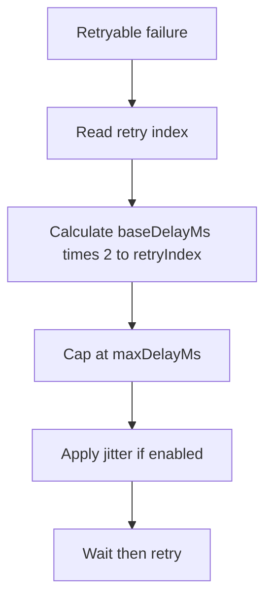

# Exponential backoff

## 1. Problem and motivation

Retry ngay lập tức hoặc delay cố định có thể liên tục dồn thêm request vào provider đang lỗi.

## 2. Design thinking

Mỗi retry sau nên chờ lâu hơn retry trước, nhưng không được tăng vô hạn. Backoff là khoảng chờ giữa các retry, không phải thay thế timeout hoặc phân loại lỗi.

## 3. Algorithm

Với retry index bắt đầu từ 0, tính delay cơ sở là `baseDelayMs × 2^retryIndex`; sau đó giới hạn ở `maxDelayMs`. Ví dụ base 200 ms tạo 200 ms, 400 ms, 800 ms trước khi chạm trần. Jitter, nếu có, được áp dụng sau bước này.

## 4. Mermaid workflow

## 5. Important implementation concepts

- Fixed delay đơn giản nhưng mọi retry có cùng nhịp.
- Exponential backoff giảm nhịp retry khi failure kéo dài.
- `maxDelayMs` ngăn delay quá lớn.
- Delay phải được tính trong timeout budget tổng, không chỉ nhìn timeout từng attempt.

## 6. Realistic example

Với `baseDelayMs = 250` và `maxDelayMs = 2000`, bốn retry có delay cơ sở lần lượt 250, 500, 1000 và 2000 ms. Retry tiếp theo vẫn là 2000 ms trước jitter.

## 7. Edge cases

- Cần validate delay là số dương và tránh arithmetic overflow.
- Không sleep nếu không còn budget cho attempt tiếp theo.
- Cần định nghĩa rõ retry index để tránh lệch một bậc delay giữa implementation và tài liệu.

## 8. Trade-offs

Backoff bảo vệ dependency tốt hơn fixed delay trong outage dài, nhưng làm kết quả lỗi cuối cùng đến muộn hơn.

## 9. Related source code

- `src/config/env.ts` có `GEMINI_RETRY_BASE_DELAY_MS` nhưng chưa có thuật toán dùng nó.
- `src/shared/async/with-retry.ts` hiện rỗng.

## 10. Related ADR

[ADR-008 — Exponential backoff](../../decisions/ADR-008-exponential-backoff.md)

> Trạng thái: Proposed. Repository hiện chưa implement exponential backoff.
