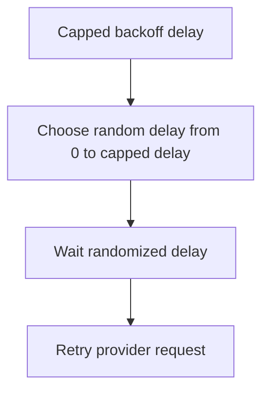

# Jitter

## 1. Problem and motivation

Khi nhiều request cùng lỗi và cùng dùng một lịch retry xác định, chúng có thể thử lại đồng thời. Đồng bộ này tạo burst lặp lại, thường gọi là thundering herd.

## 2. Design thinking

Jitter thêm ngẫu nhiên vào thời gian chờ để các request không cùng quay lại provider một lúc. Nó chỉ có ý nghĩa khi hệ thống đã quyết định retry và đã tính delay cơ sở.

## 3. Algorithm

Theo đề xuất full jitter, trước hết tính `cappedDelay` bằng backoff. Sau đó chọn ngẫu nhiên một số trong khoảng từ 0 đến `cappedDelay`; đó là delay thực tế trước attempt tiếp theo.

## 4. Mermaid workflow

## 5. Important implementation concepts

- Full jitter phân tán retry bằng random delay toàn bộ khoảng.
- Random source cần được kiểm soát/inject trong test để có kết quả deterministic.
- Jitter không quyết định lỗi nào retryable và không làm request idempotent.

## 6. Realistic example

Nếu backoff cap là 1000 ms, ba request lỗi cùng lúc có thể nhận delay 120 ms, 560 ms và 910 ms thay vì cả ba cùng retry đúng 1000 ms.

## 7. Edge cases

- Delay có thể gần 0; policy cần chấp nhận hoặc đặt minimum nếu cần.
- Randomness không bảo đảm không có hai request trùng delay.
- Nếu provider gửi `Retry-After`, cần quyết định rõ nó ưu tiên hơn hay kết hợp với jitter như thế nào.

## 8. Trade-offs

Jitter làm latency của từng request khó dự đoán hơn, đổi lại giảm nguy cơ đồng bộ retry gây tải đột biến.

## 9. Related source code

Không có source code jitter hiện tại. Vị trí hợp lý nếu triển khai là `src/shared/async/with-retry.ts`.

## 10. Related ADR

[ADR-009 — Jitter strategy](../../decisions/ADR-009-jitter-strategy.md)

> Trạng thái: Proposed. Repository hiện chưa implement jitter.
