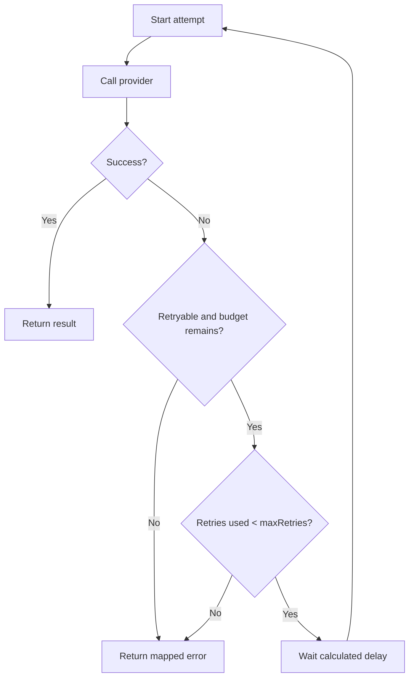

# Retry

## 1. Problem and motivation

Lỗi mạng hoặc provider tạm thời không sẵn sàng có thể tự hồi phục. Retry có thể tăng khả năng thành công, nhưng request lặp cũng có thể làm outage nặng hơn.

## 2. Design thinking

Chỉ thử lại khi lỗi có khả năng tạm thời và còn ngân sách thời gian. Không coi retry là mặc định cho mọi failure.

## 3. Algorithm

Thiết kế đề xuất bắt đầu bằng attempt đầu tiên. Khi lỗi retryable xảy ra, nếu số retry đã dùng nhỏ hơn `maxRetries` và còn timeout budget, chờ delay rồi thử lại. `maxRetries` cần được hiểu là số retry sau attempt đầu, nên tổng attempt tối đa là `1 + maxRetries`.

## 4. Mermaid workflow

## 5. Important implementation concepts

- Retryable errors cần được định nghĩa theo contract; không suy ra chỉ từ việc lỗi là exception.
- `maxRetries` không nên mơ hồ với total attempts.
- Mỗi attempt có timeout riêng vẫn có thể làm tổng latency vượt kỳ vọng nếu không có timeout budget tổng.
- Repeated requests có thể tạo cost và tải provider, kể cả khi client đã mất kết nối.

## 6. Realistic example

Giả sử `maxRetries = 2`: attempt đầu gặp `UNAVAILABLE`, retry thứ nhất cũng gặp lỗi, retry thứ hai thành công. Tổng cộng đã có ba provider request. Nếu lỗi là `INVALID_RESPONSE`, thiết kế đề xuất không retry vì cùng request có thể tiếp tục trả contract lỗi.

## 7. Edge cases

- Rate limit 429 có thể cần chính sách riêng hoặc tôn trọng thông tin retry từ provider nếu contract cung cấp.
- Không retry lỗi input, ảnh hỏng, validation response hoặc cancellation đã biết không thể phục hồi.
- Client timeout trong khi backend còn retry cần được xử lý cùng cancellation policy.

## 8. Trade-offs

Retry tăng xác suất thành công của lỗi ngắn hạn, đổi lại latency, chi phí và nguy cơ khuếch đại tải.

## 9. Related source code

- `src/config/env.ts` chứa `GEMINI_MAX_RETRIES` nhưng chưa có consumer.
- `src/shared/async/with-retry.ts` hiện rỗng.
- `src/infra/gemini/gemini-plant-analyzer.ts` chưa thực hiện retry.

## 10. Related ADR

[ADR-007 — Retry policy](../../decisions/ADR-007-retry-policy.md)
