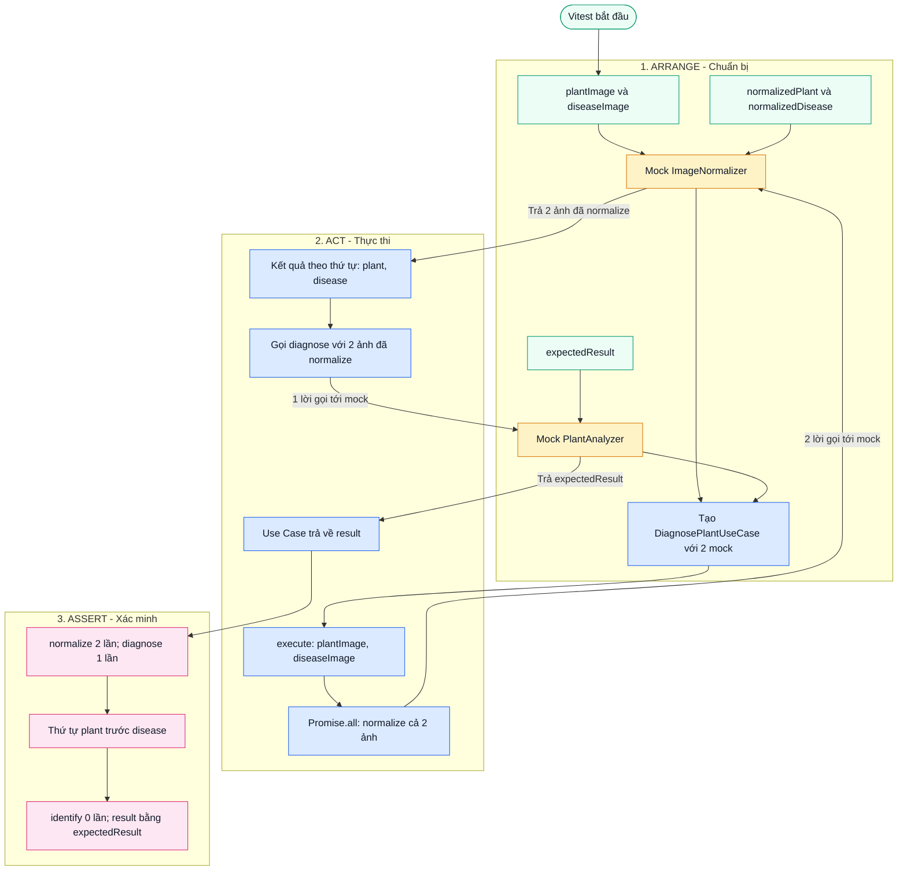

# Luồng thực thi Unit Test: DiagnosePlantUseCase

**SUT:** `DiagnosePlantUseCase.execute()` là code thật. `ImageNormalizer` và `PlantAnalyzer` là mock; test không gọi Gemini.

**Chú giải:** Xanh dương: logic Use Case; vàng: mock; xanh lá: dữ liệu test; hồng: assertion.

| Assertion | Ý nghĩa |
| --- | --- |
| `normalize` gọi 2 lần | Hai ảnh được gửi đến normalizer |
| `diagnose` gọi 1 lần | Use Case chỉ gọi một lần tới mock analyzer |
| `diagnose` nhận `[normalizedPlant, normalizedDisease]` | Giữ đúng thứ tự ảnh |
| `identify` không được gọi | Không gọi nhánh Identify |
| `result.toEqual(expectedResult)` | Use Case trả đúng kết quả từ mock |

`Promise.all()` giữ thứ tự kết quả theo input, không bảo đảm thứ tự hoàn thành và không tự tạo CPU parallelism.
