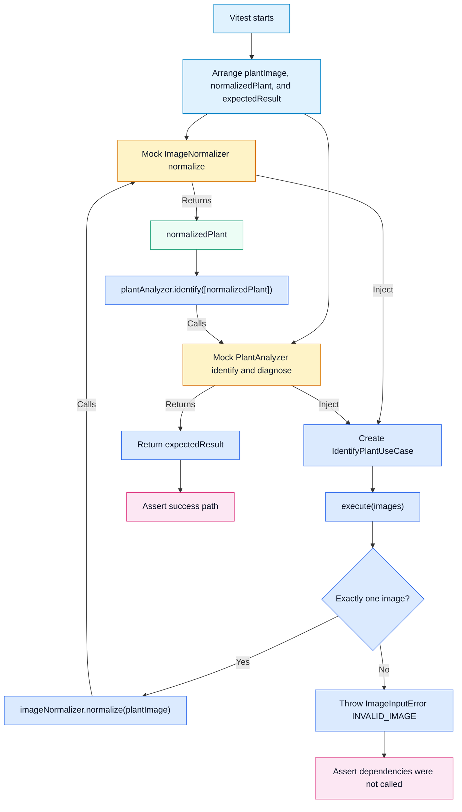

# IdentifyPlantUseCase Unit Test Workflow

`IdentifyPlantUseCase.execute()` is real production code; `ImageNormalizer` and
`PlantAnalyzer` are Vitest mocks, so no Gemini SDK or network call occurs.

**Legend:** light blue = Vitest setup; blue = real SUT logic; yellow = mock;
green = fixture value; pink = assertion.

| Assertion                                | What the test verifies                                                     |
| ---------------------------------------- | -------------------------------------------------------------------------- |
| `normalize` once with `plantImage`       | The valid path normalizes the original image.                              |
| `identify` once with `[normalizedPlant]` | Only the normalized image is identified.                                   |
| `diagnose` is not called                 | The Identify path does not diagnose.                                       |
| `result.toEqual(expectedResult)`         | The analyzer mock result is returned.                                      |
| Zero or two images                       | Rejects with `ImageInputError` / `INVALID_IMAGE`; no dependency is called. |
